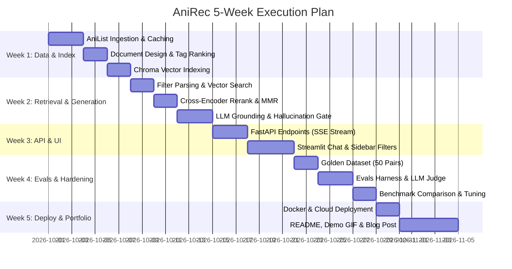

# AniRec — Master Implementation Roadmap & Step Index

AniRec is a production-grade, conversational anime recommendation engine powered by RAG (Retrieval-Augmented Generation), AniList GraphQL data, ChromaDB vector search, Cross-Encoder reranking, and LLM-as-judge evaluations.

This roadmap breaks down the entire project into **60 comprehensive, production-ready implementation steps**.

---

## 🗺️ Master Step Index

```
Phase 1: Project Foundations, Architecture & Environment (Steps 01-07)
Phase 2: AniList GraphQL Ingestion Pipeline (Steps 08-14)
Phase 3: Document Engineering & Chunking Strategy (Steps 15-19)
Phase 4: Embeddings & Vector Database Indexing (Steps 20-24)
Phase 5: Hybrid Retrieval, Reranking & Diversity (Steps 25-31)
Phase 6: Generation Layer, Grounding & Guardrails (Steps 32-37)
Phase 7: Backend API Engineering (FastAPI) (Steps 38-43)
Phase 8: Frontend Chat UI (Streamlit) (Steps 44-48)
Phase 9: Golden-Set Evaluation & LLM-as-Judge Harness (Steps 49-54)
Phase 10: Docker Containerization, Deployment & Portfolio (Steps 55-60)
```

---

### Phase 1: Project Foundations, Architecture & Environment
- [Step 01: Project Philosophy & Hiring Impact Strategy](file:///c:/Users/avina/OneDrive/Desktop/AniRec/steps/STEP_01_PROJECT_PHILOSOPHY_AND_HIRING_IMPACT.md)
- [Step 02: End-to-End System Architecture & High-Level Topology](file:///c:/Users/avina/OneDrive/Desktop/AniRec/steps/STEP_02_SYSTEM_ARCHITECTURE_AND_TOPOLOGY.md)
- [Step 03: Tech Stack Selection & Provider Abstraction Design](file:///c:/Users/avina/OneDrive/Desktop/AniRec/steps/STEP_03_TECH_STACK_AND_PROVIDER_ABSTRACTIONS.md)
- [Step 04: Development Environment Setup & Tooling Configuration](file:///c:/Users/avina/OneDrive/Desktop/AniRec/steps/STEP_04_DEV_ENVIRONMENT_AND_TOOLING_SETUP.md)
- [Step 05: Configuration Management & Secrets Architecture](file:///c:/Users/avina/OneDrive/Desktop/AniRec/steps/STEP_05_CONFIGURATION_AND_SECRETS_MANAGEMENT.md)
- [Step 06: Logging, Structured Tracing & Observability Foundations](file:///c:/Users/avina/OneDrive/Desktop/AniRec/steps/STEP_06_LOGGING_TRACING_AND_OBSERVABILITY.md)
- [Step 07: Unified Repository Directory Structure Blueprint](file:///c:/Users/avina/OneDrive/Desktop/AniRec/steps/STEP_07_REPOSITORY_DIRECTORY_BLUEPRINT.md)

---

### Phase 2: AniList GraphQL Ingestion Pipeline
- [Step 08: AniList GraphQL Schema Discovery & Query Crafting](file:///c:/Users/avina/OneDrive/Desktop/AniRec/steps/STEP_08_ANILIST_GRAPHQL_SCHEMA_AND_QUERIES.md)
- [Step 09: API Rate Limiter & Throttling Engine](file:///c:/Users/avina/OneDrive/Desktop/AniRec/steps/STEP_09_API_RATE_LIMITER_AND_THROTTLING.md)
- [Step 10: Raw Data Disk Snapshot Storage (`data/raw`)](file:///c:/Users/avina/OneDrive/Desktop/AniRec/steps/STEP_10_RAW_DATA_SNAPSHOT_STORAGE.md)
- [Step 11: Fault-Tolerant Pagination & Retry Engine](file:///c:/Users/avina/OneDrive/Desktop/AniRec/steps/STEP_11_PAGINATION_AND_RETRY_ENGINE.md)
- [Step 12: Anime Metadata Extraction & Field Sanitization](file:///c:/Users/avina/OneDrive/Desktop/AniRec/steps/STEP_12_ANIME_METADATA_EXTRACTION.md)
- [Step 13: Franchise Relationship Graph & Lineage Modeling](file:///c:/Users/avina/OneDrive/Desktop/AniRec/steps/STEP_13_FRANCHISE_RELATIONS_GRAPH_MODELING.md)
- [Step 14: Data Validation & Quality Pipeline with Pydantic](file:///c:/Users/avina/OneDrive/Desktop/AniRec/steps/STEP_14_DATA_VALIDATION_AND_QUALITY_PIPELINE.md)

---

### Phase 3: Document Engineering & Chunking Strategy
- [Step 15: Single-Doc-per-Show Paradigm vs Chunking Justification](file:///c:/Users/avina/OneDrive/Desktop/AniRec/steps/STEP_15_DOCUMENT_DESIGN_AND_CHUNKING_JUSTIFICATION.md)
- [Step 16: Weighted Tag Rank Integration Engine](file:///c:/Users/avina/OneDrive/Desktop/AniRec/steps/STEP_16_WEIGHTED_TAG_RANK_INTEGRATION.md)
- [Step 17: Document Text Formatter & Context Assembly](file:///c:/Users/avina/OneDrive/Desktop/AniRec/steps/STEP_17_DOCUMENT_TEXT_ASSEMBLY_PIPELINE.md)
- [Step 18: Metadata Schema Construction for Vector Filtering](file:///c:/Users/avina/OneDrive/Desktop/AniRec/steps/STEP_18_METADATA_FILTERING_SCHEMA.md)
- [Step 19: Processed Snapshot Persistence (`data/processed`)](file:///c:/Users/avina/OneDrive/Desktop/AniRec/steps/STEP_19_PROCESSED_DATA_SNAPSHOT_STORAGE.md)

---

### Phase 4: Embeddings & Vector Database Indexing
- [Step 20: Embedding Model Selection & Benchmarking](file:///c:/Users/avina/OneDrive/Desktop/AniRec/steps/STEP_20_EMBEDDING_MODEL_SELECTION_AND_BENCHMARKS.md)
- [Step 21: Abstract Embedder Interface (`BaseEmbedder`)](file:///c:/Users/avina/OneDrive/Desktop/AniRec/steps/STEP_21_ABSTRACT_EMBEDDER_INTERFACE.md)
- [Step 22: ChromaDB Persistent Collection Setup & Vector Config](file:///c:/Users/avina/OneDrive/Desktop/AniRec/steps/STEP_22_CHROMADB_COLLECTION_AND_PERSISTENCE.md)
- [Step 23: Batch Indexing Pipeline with Upsert & Progress Tracking](file:///c:/Users/avina/OneDrive/Desktop/AniRec/steps/STEP_23_BATCH_INDEXING_AND_UPSERT_ENGINE.md)
- [Step 24: Vector Index Verification & Sanity Search Script](file:///c:/Users/avina/OneDrive/Desktop/AniRec/steps/STEP_24_VECTOR_INDEX_SANITY_VERIFICATION.md)

---

### Phase 5: Hybrid Retrieval, Reranking & Diversity
- [Step 25: Query Understanding — Rules-Based / Regex Filter Parser](file:///c:/Users/avina/OneDrive/Desktop/AniRec/steps/STEP_25_RULES_BASED_QUERY_FILTER_PARSER.md)
- [Step 26: Query Understanding — Structured LLM Filter Extraction](file:///c:/Users/avina/OneDrive/Desktop/AniRec/steps/STEP_26_LLM_STRUCTURED_QUERY_UNDERSTANDING.md)
- [Step 27: Semantic Vector Search with Metadata `where` Clauses](file:///c:/Users/avina/OneDrive/Desktop/AniRec/steps/STEP_27_SEMANTIC_VECTOR_SEARCH_WITH_METADATA.md)
- [Step 28: Progressive Filter Relaxation Strategy](file:///c:/Users/avina/OneDrive/Desktop/AniRec/steps/STEP_28_PROGRESSIVE_FILTER_RELAXATION.md)
- [Step 29: Cross-Encoder Reranker Integration (`ms-marco-MiniLM-L-6-v2`)](file:///c:/Users/avina/OneDrive/Desktop/AniRec/steps/STEP_29_CROSS_ENCODER_RERANKING.md)
- [Step 30: Franchise Deduplication & Lineage Collapse Algorithm](file:///c:/Users/avina/OneDrive/Desktop/AniRec/steps/STEP_30_FRANCHISE_DEDUPLICATION_ALGORITHM.md)
- [Step 31: Maximal Marginal Relevance (MMR) & Diversity Filtering](file:///c:/Users/avina/OneDrive/Desktop/AniRec/steps/STEP_31_MAXIMAL_MARGINAL_RELEVANCE_DIVERSITY.md)

---

### Phase 6: Generation Layer, Grounding & Guardrails
- [Step 32: Abstract LLM Provider Interface (`BaseChatModel`)](file:///c:/Users/avina/OneDrive/Desktop/AniRec/steps/STEP_32_ABSTRACT_LLM_CLIENT_INTERFACE.md)
- [Step 33: Grounded System Prompt Engineering & Citation Design](file:///c:/Users/avina/OneDrive/Desktop/AniRec/steps/STEP_33_GROUNDED_SYSTEM_PROMPT_ENGINEERING.md)
- [Step 34: Strict JSON Mode Output Contract](file:///c:/Users/avina/OneDrive/Desktop/AniRec/steps/STEP_34_JSON_MODE_OUTPUT_CONTRACT.md)
- [Step 35: Anti-Hallucination Post-Generation Verification Gate](file:///c:/Users/avina/OneDrive/Desktop/AniRec/steps/STEP_35_ANTI_HALLUCINATION_POST_CHECK_GATE.md)
- [Step 36: Generation Self-Correction & Fallback Pipeline](file:///c:/Users/avina/OneDrive/Desktop/AniRec/steps/STEP_36_GENERATION_SELF_CORRECTION_FALLBACK.md)
- [Step 37: Spoiler Leakage Prevention & Scope Boundaries](file:///c:/Users/avina/OneDrive/Desktop/AniRec/steps/STEP_37_SPOILER_PREVENTION_AND_BOUNDARIES.md)

---

### Phase 7: Backend API Engineering (FastAPI)
- [Step 38: FastAPI Application Initialization, Middleware & CORS](file:///c:/Users/avina/OneDrive/Desktop/AniRec/steps/STEP_38_FASTAPI_INITIALIZATION_AND_CORS.md)
- [Step 39: Pydantic Request/Response API Schemas](file:///c:/Users/avina/OneDrive/Desktop/AniRec/steps/STEP_39_PYDANTIC_API_REQUEST_RESPONSE_SCHEMAS.md)
- [Step 40: `POST /recommend` One-Shot Endpoint Implementation](file:///c:/Users/avina/OneDrive/Desktop/AniRec/steps/STEP_40_POST_RECOMMEND_ENDPOINT.md)
- [Step 41: `POST /chat` Multi-Turn SSE Streaming Endpoint](file:///c:/Users/avina/OneDrive/Desktop/AniRec/steps/STEP_41_POST_CHAT_SSE_STREAMING_ENDPOINT.md)
- [Step 42: `GET /anime/{id}` Show Detail & `GET /health` Endpoints](file:///c:/Users/avina/OneDrive/Desktop/AniRec/steps/STEP_42_ANIME_DETAILS_AND_HEALTHCHECK_ENDPOINTS.md)
- [Step 43: API Latency Profiling & Token Cost Tracking Middleware](file:///c:/Users/avina/OneDrive/Desktop/AniRec/steps/STEP_43_API_LATENCY_AND_COST_MONITORING.md)

---

### Phase 8: Frontend Chat UI (Streamlit)
- [Step 44: Streamlit App Initialization & Session State Architecture](file:///c:/Users/avina/OneDrive/Desktop/AniRec/steps/STEP_44_STREAMLIT_STATE_AND_CONFIG.md)
- [Step 45: SSE Streaming Chat Consumer & Markdown Renderer](file:///c:/Users/avina/OneDrive/Desktop/AniRec/steps/STEP_45_STREAMLIT_SSE_STREAMING_CHAT_UI.md)
- [Step 46: Interactive Sidebar Filters (Genres, Year Slider, Score, Format)](file:///c:/Users/avina/OneDrive/Desktop/AniRec/steps/STEP_46_STREAMLIT_INTERACTIVE_SIDEBAR_FILTERS.md)
- [Step 47: "Why This Recommendation?" Explainability Expander Panel](file:///c:/Users/avina/OneDrive/Desktop/AniRec/steps/STEP_47_STREAMLIT_EXPLAINABILITY_PANEL.md)
- [Step 48: User Feedback Thumbs-Up/Down Logger](file:///c:/Users/avina/OneDrive/Desktop/AniRec/steps/STEP_48_USER_FEEDBACK_LOGGER_COMPONENT.md)

---

### Phase 9: Golden-Set Evaluation & LLM-as-Judge Harness
- [Step 49: Golden Dataset Authoring (50 Domain-Expert Q&A Pairs)](file:///c:/Users/avina/OneDrive/Desktop/AniRec/steps/STEP_49_GOLDEN_DATASET_AUTHORING_50_PAIRS.md)
- [Step 50: Retrieval Metrics Implementation (Hit Rate @ 5, MRR)](file:///c:/Users/avina/OneDrive/Desktop/AniRec/steps/STEP_50_RETRIEVAL_METRICS_HIT_RATE_AND_MRR.md)
- [Step 51: Generation Metrics & LLM-as-Judge Implementation](file:///c:/Users/avina/OneDrive/Desktop/AniRec/steps/STEP_51_GENERATION_METRICS_FAITHFULNESS_AND_JUDGE.md)
- [Step 52: Automated Evals Harness Runner (`run_evals.py`)](file:///c:/Users/avina/OneDrive/Desktop/AniRec/steps/STEP_52_AUTOMATED_EVALS_HARNESS_RUNNER.md)
- [Step 53: Timestamped Eval Results Storage & Comparison Reporter](file:///c:/Users/avina/OneDrive/Desktop/AniRec/steps/STEP_53_EVAL_BENCHMARK_COMPARISON_REPORTER.md)
- [Step 54: Iterative Optimization Experiments & Baseline Progression](file:///c:/Users/avina/OneDrive/Desktop/AniRec/steps/STEP_54_ITERATIVE_OPTIMIZATION_EXPERIMENTS.md)

---

### Phase 10: Production Containerization, Deployment & Portfolio
- [Step 55: Multi-Stage Dockerfile Containerization](file:///c:/Users/avina/OneDrive/Desktop/AniRec/steps/STEP_55_DOCKERFILE_MULTI_STAGE_CONTAINERIZATION.md)
- [Step 56: Docker Compose Multi-Service Orchestration](file:///c:/Users/avina/OneDrive/Desktop/AniRec/steps/STEP_56_DOCKER_COMPOSE_ORCHESTRATION.md)
- [Step 57: Cloud Deployment Runbook (Hugging Face / Render / Fly.io)](file:///c:/Users/avina/OneDrive/Desktop/AniRec/steps/STEP_57_CLOUD_DEPLOYMENT_RUNBOOK.md)
- [Step 58: Production README, Architecture Diagrams & Demo GIF](file:///c:/Users/avina/OneDrive/Desktop/AniRec/steps/STEP_58_PRODUCTION_README_AND_ASSET_SHOWCASE.md)
- [Step 59: Technical Blog Post & Resume Bullet Point Packaging](file:///c:/Users/avina/OneDrive/Desktop/AniRec/steps/STEP_59_TECHNICAL_BLOG_POST_AND_RESUME_GUIDE.md)
- [Step 60: Advanced Stretch Goals Roadmap (AniList Profile Sync, pgvector, Langfuse)](file:///c:/Users/avina/OneDrive/Desktop/AniRec/steps/STEP_60_STRETCH_GOALS_AND_FUTURE_ROADMAP.md)

---

## ⚡ Execution Timeline (5-Week Plan)


