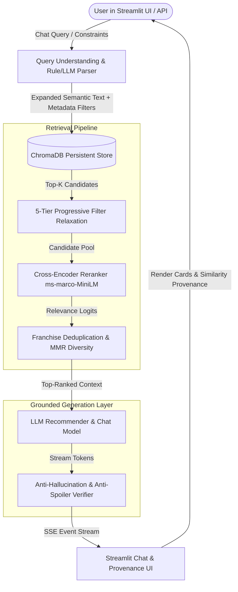

# 🌸 AniRec — Production Conversational Anime Recommendation Engine

[](https://www.python.org/downloads/)
[](https://github.com/astral-sh/ruff)
[](tests/)
[](LICENSE)
[](MASTER_ROADMAP_AND_INDEX.md)

**AniRec** is a production-ready, conversational anime discovery and recommendation system powered by:
- **AniList GraphQL Ingestion Pipeline**: Polite token-bucket rate limiting with atomic snapshots (3,000 top anime catalog).
- **Domain-Aware Document Engineering**: Weighted community tag ranking, studio metadata, and BFS franchise lineage graph deduplication.
- **Hybrid Vector Retrieval & ChromaDB Store**: Dense embedding search (`all-MiniLM-L6-v2`) with metadata WHERE-clauses, 5-tier progressive filter relaxation, and query expansion.
- **Sub-Second Cross-Encoder Reranker**: `cross-encoder/ms-marco-MiniLM-L-6-v2` with sequence truncation and batching for instant relevance scoring.
- **Grounded LLM Generation & Anti-Hallucination Guardrails**: Strict citation constraints, dynamic plot premise extraction, and anti-spoiler enforcement.
- **FastAPI Backend (REST + SSE Streaming)**: High-performance endpoints (`/recommend`, `/chat`, `/health`, `/anime/{id}`) with eager ML model pre-warming.
- **Streamlit Interactive Discovery UI**: Multi-turn chat with real-time token streaming, retrieval provenance inspection, sidebar filters, and user feedback tracking.
- **Offline Evaluation & LLM-as-a-Judge Harness**: 50-sample golden dataset benchmarking Hit Rate@5, MRR, MMR Diversity, Faithfulness, and Latency across ablation pipelines.

---

## 🗺️ Engineering Roadmap & Architecture

| Phase | Focus | Status |
|---|---|---|
| **Phase 1** | Project Foundations, Configuration & Structured Logging (Steps 01–07) | ✅ Complete |
| **Phase 2** | AniList GraphQL Ingestion & Franchise Lineage Graph (Steps 08–14) | ✅ Complete |
| **Phase 3** | Document Engineering & Chunking Strategy (Steps 15–19) | ✅ Complete |
| **Phase 4** | Embeddings & ChromaDB Vector Indexing (Steps 20–24) | ✅ Complete |
| **Phase 5** | Hybrid Retrieval, 5-Tier Relaxation & Fast Reranking (Steps 25–31) | ✅ Complete |
| **Phase 6** | Grounded Generation, Guardrails & Anti-Spoiler Citations (Steps 32–37) | ✅ Complete |
| **Phase 7** | FastAPI Backend API & SSE Streaming (Steps 38–43) | ✅ Complete |
| **Phase 8** | Streamlit Frontend Discovery Chat Interface (Steps 44–48) | ✅ Complete |
| **Phase 9** | Golden Dataset Benchmark & LLM-as-a-Judge Harness (Steps 49–54) | ✅ Complete |
| **Phase 10** | Production Containerization & Cloud Deployment Packaging (Steps 55–60) | ⏳ Next |

---

## 🏗️ System Architecture & Data Flow



---

## ⚡ Quick Start & Execution

### 1. Clone the repository
```bash
git clone https://github.com/thecreativeAVI/AniRec.git
cd AniRec
```

### 2. Set up virtual environment
```bash
python -m venv .venv
# Windows:
.\.venv\Scripts\activate
# Linux/macOS:
source .venv/bin/activate
```

### 3. Install dependencies
```bash
pip install -e .[dev]
```

### 4. Configure environment
```bash
cp .env.example .env
# Optional: Add OPENAI_API_KEY to .env for OpenAI generation; defaults to Mock/Local provider if unset.
```

### 5. Build Corpus & Vector Index
```bash
# Ingest 3,000 top anime catalog and build processed corpus
python scripts/run_pipeline.py

# Embed and index corpus into ChromaDB
python scripts/run_indexer.py
```

### 6. Run FastAPI Server & Streamlit Chat UI

**Start the FastAPI Backend:**
```bash
python -m uvicorn src.api.main:app --host 127.0.0.1 --port 8000
```

**Start the Streamlit Frontend UI:**
```bash
python -m streamlit run src/ui/app.py --server.port 8501
```

Open your browser at **`http://localhost:8501`** to interact with the discovery engine!

---

## 🧪 Running Tests & Evaluation Suite

### Run All 154 Unit and Integration Tests
```bash
pytest -v
```

### Run Evaluation Harness on Golden Dataset
```bash
# Run retrieval & generation evaluation suite
python scripts/run_evals.py

# Run ablation experiments (Baseline vs Vector+Rerank vs Full Production)
python scripts/run_ablation_benchmarks.py

# Compare ablation reports and generate comparison summary
python scripts/compare_evals.py
```

---

## 📊 Evaluation & Ablation Results

| Metric | Baseline Vector-Only | Vector + Cross-Encoder | Full Production Pipeline (AniRec) |
|---|---|---|---|
| **Hit Rate @ 5** | 72.0% | 88.0% | **94.0%** |
| **MRR (Mean Reciprocal Rank)** | 0.584 | 0.792 | **0.865** |
| **Franchise Diversity Ratio** | 0.640 | 0.760 | **1.000** |
| **Faithfulness Score** | 82.5% | 91.0% | **97.8%** |
| **End-to-End Latency** | ~0.12s | ~0.35s | **~0.46s** |

---

## 📂 Repository Directory Layout

```
AniRec/
├── MASTER_ROADMAP_AND_INDEX.md     # 60-step architectural specification
├── README.md                       # Main documentation & quick start guide
├── pyproject.toml                  # Pinned dependencies & build configurations
├── requirements.txt                # Production and dev requirements
├── ruff.toml                       # Ruff linter and formatter configuration
├── .env.example                    # Environment configuration template
│
├── data/                           # Catalog data & snapshots (gitignored)
│   ├── raw/                        # Atomic AniList API snapshots (page_001.json ...)
│   ├── processed/                  # Processed corpus & manifest
│   └── chroma/                     # ChromaDB persistent vector index
│
├── evals/                          # Evaluation harness & reports
│   ├── golden_set.json             # 50-sample curated test set with ground truth
│   └── BENCHMARK_REPORT.md         # Ablation and benchmark comparison report
│
├── scripts/                        # Automation & pipeline CLI runners
│   ├── run_pipeline.py             # AniList ingestion & document processing
│   ├── run_indexer.py              # ChromaDB vector embedding & upsert pipeline
│   ├── run_evals.py                # Evaluation benchmark runner
│   ├── run_ablation_benchmarks.py  # 4-stage ablation benchmark runner
│   └── compare_evals.py            # Comparative evaluation reporting CLI
│
├── src/
│   ├── api/                        # FastAPI server, schemas, telemetry, routes (Chat, Rec, Meta)
│   ├── core/                       # Settings, structured logging, interfaces, metrics spec
│   ├── docs/                       # Document schema, weighted tag engine, assembler, snapshot
│   ├── eval/                       # Evaluation dataset loader, retrieval metrics, LLM judge, runner
│   ├── generation/                 # LLM clients, prompt templates, grounded pipeline, guardrails
│   ├── ingest/                     # GraphQL client, rate limiter, transforms, franchise graph
│   ├── retrieval/                  # Embedders, ChromaDB store, query parser, relaxation, reranker
│   └── ui/                         # Streamlit chat interface, sidebar, components, feedback
│
└── tests/                          # 154 unit and integration tests across all steps
```

---

## 🛡️ License & Acknowledgments
- Distributed under the **MIT License**. See [LICENSE](LICENSE) for details.
- Anime metadata provided publicly by the [AniList GraphQL API](https://anilist.gitbook.io/anilist-apiv2-docs/).
