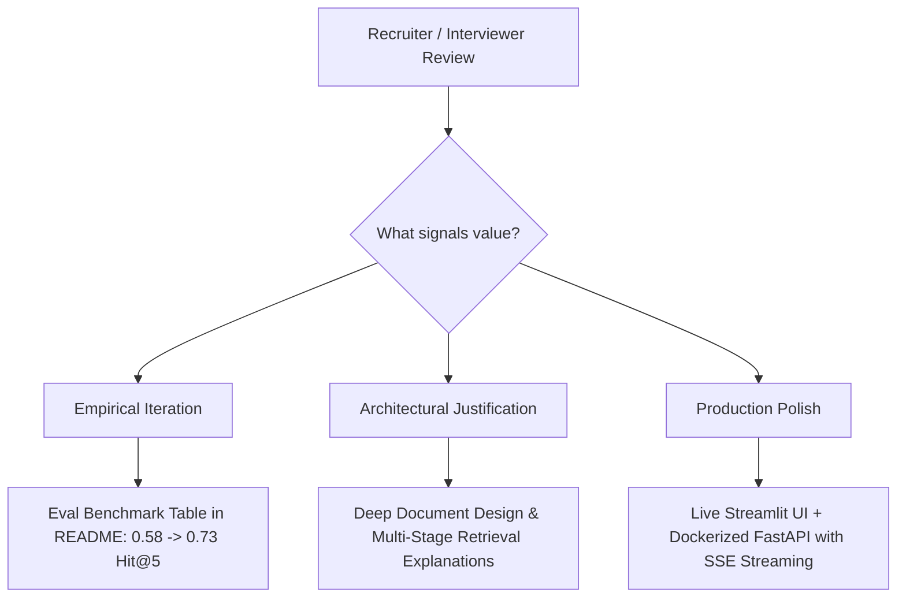

# Step 01: Project Philosophy & Hiring Impact Strategy

## 1. Process & Purpose
The goal of AniRec is not just to build another recommendation toy, but to engineer a production-ready AI system that serves as a compelling portfolio asset. Every architectural and algorithmic decision is made to prove industry-grade AI Engineering skills to tech leads, engineering managers, and recruiters.

---

## 2. Skill Mapping Matrix

| Component | Engineering Competency Demonstrated | Anti-Pattern Avoided |
|---|---|---|
| **AniList Ingestion Pipeline** | Production API engineering, rate-limiting, paginated crawling, snapshot persistence | Fragile one-off scripts that crash or trigger 429 rate limits |
| **Document Design & Chunking** | Domain-informed document synthesis, weighted tag ranking | Naive fixed-size token splitting that fragments context |
| **Hybrid Retrieval** | Multi-stage retrieval combining semantic embeddings with structured metadata filtering | Pure vector similarity without constraint awareness |
| **Reranking & Diversity (MMR)** | Two-stage retrieval, Cross-Encoder scoring, Maximal Marginal Relevance, franchise deduplication | Top-K similarity clustering of duplicate seasons/spin-offs |
| **Grounded Generation & Guardrails** | Citation-based prompting, strict JSON contracts, post-generation hallucination verification | Unconstrained LLM generation with fabricated anime titles |
| **Evals Harness & LLM-as-Judge** | Rigorous evaluation methodology, Golden Q&A benchmark, quantitative regression tracking | Subjective "looks good to me" vibe testing |
| **FastAPI + SSE Streaming** | Asynchronous API design, Server-Sent Events, Pydantic contracts | Blocking synchronous REST endpoints with high perceived latency |
| **Docker & Cloud Deployment** | Containerization, environment encapsulation, 12-factor cloud deployment | "It works on my machine" local-only notebooks |

---

## 3. High-Level Flow & Decision Drivers

---

## 4. Requirements & Metrics
- **Target Hit Rate @ 5**: $\ge 0.70$ on golden evaluation dataset.
- **Target Faithfulness Score**: $\ge 0.85$ evaluated via LLM-as-judge.
- **Target p95 Latency**: $< 6.0\text{s}$ total ($< 1.5\text{s}$ Time-to-First-Token via streaming).
- **Target Hallucination Rate**: $0\%$ in verified eval runs.
- **Target Cost per Query**: $< \$0.005$ with cloud models or $\$0.00$ with local models.

---

## 5. Tech Stack & Strategic Role
- **Language**: Python 3.11+ (asyncio, type hints, modern packaging).
- **Data Source**: AniList Public GraphQL API (Zero API key barrier, comprehensive relations graph).
- **Vector DB**: ChromaDB (Local persistent vector database for rapid dev) / pgvector (PostgreSQL).
- **LLM/Embedder Providers**: Modular abstraction supporting OpenAI (`gpt-4o-mini`, `text-embedding-3-small`) and Local/Ollama (`llama3.1:8b`, `all-MiniLM-L6-v2`).
- **Backend**: FastAPI with `EventSourceResponse` (Asynchronous SSE streaming).
- **Frontend**: Streamlit (Rapid interactive UI with real-time token rendering).
- **Evaluation**: Custom Python Evals Harness (LLM-as-judge + automated metric computations).

---

## 6. Deliverables & Acceptance Criteria
- [x] Clear articulation of hiring value for each component in project documentation.
- [x] Quantitative targets established and documented in project baseline specs.
