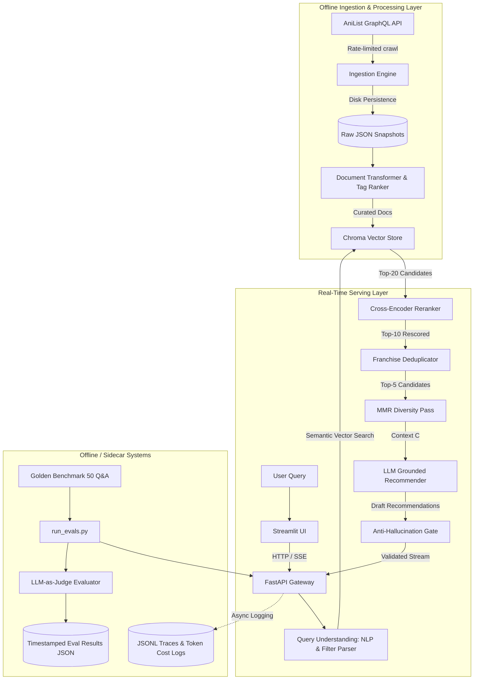

# Step 02: End-to-End System Architecture & High-Level Topology

## 1. Process & Purpose
AniRec's architecture coordinates distinct asynchronous subsystems: an offline ingestion & document synthesis pipeline, a low-latency multi-stage retrieval pipeline, a grounded generation and validation engine, an observability sidecar, and an evaluation harness.

---

## 2. End-to-End System Architecture Diagram

---

## 3. Request-Response Execution Flow (Step-by-Step)
1. **User Request**: User inputs query: *"I want FMAB's politics but darker, 2015 or later"*.
2. **Query Understanding**:
   - Semantic text extracted: `"politics, dark, military, moral ambiguity"`.
   - Structured filter extracted: `{"seasonYear": {"$gte": 2015}}`.
3. **Filtered Vector Search**: Chroma queries embeddings with metadata filter to retrieve Top-20 candidates.
4. **Cross-Encoder Reranking**: `ms-marco-MiniLM-L-6-v2` calculates cross-attention relevance scores for query vs candidates.
5. **Franchise Deduplication**: AniList relations tree is traversed; redundant seasons/prequels are pruned or grouped.
6. **Diversity Pass (MMR)**: Maximal Marginal Relevance balances relevance with diversity.
7. **Grounded Generation**: LLM generates structured recommendations citing exact retrieved titles and attributes.
8. **Anti-Hallucination Gate**: Title presence assertion ensures every suggested anime was retrieved.
9. **SSE Streaming Delivery**: Response streams token-by-token to Streamlit UI with explainability metadata.
10. **Observability**: Metrics (latency per stage, token count, cost) are logged to JSONL.

---

## 4. Requirements & Dependencies
- Asynchronous pipeline coordination using Python `asyncio`.
- Decoupled interfaces between Data, Vector Store, Retrieval, Generation, and API layers.
- Strict data contracts between components using Pydantic models.

---

## 5. Deliverables & Acceptance Criteria
- [x] Clear architectural separation of concerns between offline indexing and online serving.
- [x] Strict 10-step request execution lifecycle documented and verified.
