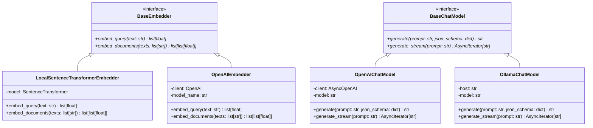

# Step 03: Tech Stack Selection & Provider Abstraction Design

## 1. Process & Purpose
To ensure zero vendor lock-in, low operating cost during local development, and seamless cloud scalability, AniRec abstracts core AI providers (Embeddings & LLMs) behind unified abstract base interfaces (`BaseEmbedder` and `BaseChatModel`).

---

## 2. Tech Stack Decision Matrix

| Subsystem | Primary Choice | Alternative / Future | Selection Rationale |
|---|---|---|---|
| **Embeddings** | `sentence-transformers/all-MiniLM-L6-v2` | OpenAI `text-embedding-3-small` | 384 dimensions, local inference, 0 API cost, fast on CPU/GPU |
| **Vector Store** | `ChromaDB` (Persistent) | `pgvector` (PostgreSQL) | Native Python support, disk persistence, zero external DB setup |
| **LLM** | OpenAI `gpt-4o-mini` | Ollama `llama3.1:8b` | High JSON-mode adherence, fast generation, low cost (~$0.15/1M tokens) |
| **Reranker** | `cross-encoder/ms-marco-MiniLM-L-6-v2` | Cohere Rerank API | High-quality cross-attention scoring with zero cloud latency/cost |
| **Backend** | `FastAPI` + `Uvicorn` | `Flask` / `Litestar` | Native async support, automatic OpenAPI docs, Pydantic integration |
| **Frontend** | `Streamlit` | `React` + `Vite` | Fast iteration, built-in chat UI components, python-native |
| **Validation** | `Pydantic v2` | `dataclasses` | High performance Rust-backed validation, schema serialization |

---

## 3. Abstract Interface Architecture



---

## 4. Code Sample: Interface Contracts

```python
# src/core/interfaces.py
from abc import ABC, abstractmethod
from typing import AsyncIterator, List, Dict, Any, Optional

class BaseEmbedder(ABC):
    @abstractmethod
    def embed_query(self, text: str) -> List[float]:
        """Generate embedding vector for a single query text."""
        pass

    @abstractmethod
    def embed_documents(self, texts: List[str]) -> List[List[float]]:
        """Generate embedding vectors for a list of document strings."""
        pass

class BaseChatModel(ABC):
    @abstractmethod
    async def generate(self, prompt: str, system_prompt: Optional[str] = None, json_mode: bool = True) -> str:
        """Execute one-shot generation."""
        pass

    @abstractmethod
    async def generate_stream(self, prompt: str, system_prompt: Optional[str] = None) -> AsyncIterator[str]:
        """Stream generated response tokens asynchronously."""
        pass
```

---

## 5. Deliverables & Acceptance Criteria
- [x] Defined provider contracts for both Embeddings and LLMs.
- [x] Pluggable architecture allowing switching between Local and Cloud runtimes via environment flags.
