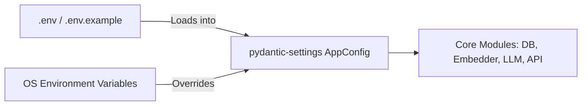

# Step 05: Configuration Management & Secrets Architecture

## 1. Process & Purpose
Manage all application settings, model names, database paths, and API keys through a centralized, type-safe `pydantic-settings` model backed by `.env` files and environment variables.

---

## 2. Configuration Schema Architecture



---

## 3. Configuration Model Implementation

```python
# src/core/config.py
from pathlib import Path
from typing import Literal
from pydantic_settings import BaseSettings, SettingsConfigDict

class Settings(BaseSettings):
    # App Settings
    APP_NAME: str = "AniRec"
    ENVIRONMENT: Literal["development", "staging", "production"] = "development"
    DEBUG: bool = False
    
    # Path Settings
    BASE_DIR: Path = Path(__file__).resolve().parent.parent.parent
    DATA_DIR: Path = BASE_DIR / "data"
    RAW_DATA_DIR: Path = DATA_DIR / "raw"
    PROCESSED_DATA_DIR: Path = DATA_DIR / "processed"
    CHROMA_PERSIST_DIR: Path = DATA_DIR / "chroma"
    LOGS_DIR: Path = BASE_DIR / "logs"
    
    # AI / Model Provider Settings
    EMBEDDING_PROVIDER: Literal["local", "openai"] = "local"
    LOCAL_EMBEDDING_MODEL: str = "sentence-transformers/all-MiniLM-L6-v2"
    OPENAI_EMBEDDING_MODEL: str = "text-embedding-3-small"
    
    LLM_PROVIDER: Literal["openai", "ollama"] = "openai"
    OPENAI_API_KEY: str = ""
    OPENAI_MODEL: str = "gpt-4o-mini"
    OLLAMA_BASE_URL: str = "http://localhost:11434"
    OLLAMA_MODEL: str = "llama3.1:8b"
    
    # Ingestion & Crawler Settings
    ANILIST_API_URL: str = "https://graphql.anilist.co"
    ANILIST_MAX_PAGES: int = 60 # 60 pages * 50 per page = 3,000 shows
    ANILIST_PER_PAGE: int = 50
    ANILIST_RATE_LIMIT_DELAY_SECONDS: float = 0.8
    
    # Retrieval Settings
    TOP_K_RETRIEVAL: int = 20
    TOP_K_RERANKED: int = 5
    CROSS_ENCODER_MODEL: str = "cross-encoder/ms-marco-MiniLM-L-6-v2"
    
    model_config = SettingsConfigDict(
        env_file=".env",
        env_file_encoding="utf-8",
        extra="ignore"
    )

settings = Settings()
```

---

## 4. `.env.example` Template

```env
# Application Settings
ENVIRONMENT=development
DEBUG=true

# AI Provider Credentials
OPENAI_API_KEY=sk-your-openai-api-key-here
LLM_PROVIDER=openai
EMBEDDING_PROVIDER=local

# Optional: Local Ollama URL
OLLAMA_BASE_URL=http://localhost:11434
```

---

## 5. Deliverables & Acceptance Criteria
- [x] Strongly typed `Settings` singleton loaded via `pydantic-settings`.
- [x] `.env.example` committed with documentation for all required and optional environment keys.
- [x] Dynamic filesystem paths resolved relative to project root.
