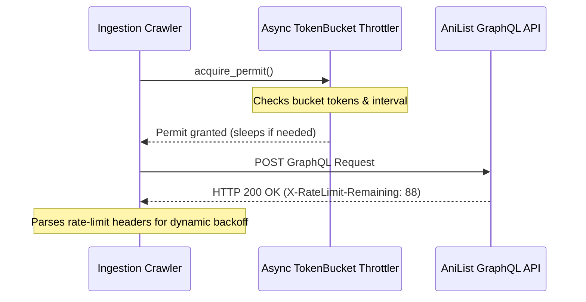

# Step 09: API Rate Limiter & Throttling Engine

## 1. Process & Purpose
AniList enforces a strict rate limit of approximately **90 requests per minute**. Violating this results in HTTP 429 errors and temporary IP bans. This module builds an asynchronous rate-limiter and polite delay governor to ensure smooth, uninterrupted crawling.

---

## 2. Rate Limiting Architecture



---

## 3. Implementation: Async Token Bucket Limiter

```python
# src/ingest/rate_limiter.py
import asyncio
import time
from src.core.logger import logger

class AsyncRateLimiter:
    def __init__(self, max_rate: int = 80, time_period: float = 60.0):
        """
        max_rate: Maximum requests allowed per time_period (AniList limit is 90/min, default safe: 80/min)
        time_period: Time window in seconds (60.0s)
        """
        self.max_rate = max_rate
        self.time_period = time_period
        self.tokens = max_rate
        self.last_refill = time.monotonic()
        self._lock = asyncio.Lock()

    async def acquire(self):
        async with self._lock:
            while True:
                now = time.monotonic()
                elapsed = now - self.last_refill
                
                # Refill tokens based on elapsed time
                refill_amount = elapsed * (self.max_rate / self.time_period)
                self.tokens = min(self.max_rate, self.tokens + refill_amount)
                self.last_refill = now
                
                if self.tokens >= 1.0:
                    self.tokens -= 1.0
                    return
                
                # Calculate sleep duration needed for 1 token
                sleep_duration = (1.0 - self.tokens) * (self.time_period / self.max_rate)
                await asyncio.sleep(sleep_duration)

    async def handle_rate_limit_headers(self, headers: dict):
        remaining = int(headers.get("X-RateLimit-Remaining", 90))
        if remaining < 5:
            retry_after = int(headers.get("Retry-After", 10))
            logger.logger.warning(f"AniList rate limit nearly exhausted. Backing off for {retry_after}s...")
            await asyncio.sleep(retry_after)
```

---

## 4. Deliverables & Acceptance Criteria
- [x] Asynchronous rate-limiter supporting concurrency-safe token consumption.
- [x] Header-based dynamic backoff supporting `X-RateLimit-Remaining` and `Retry-After`.
