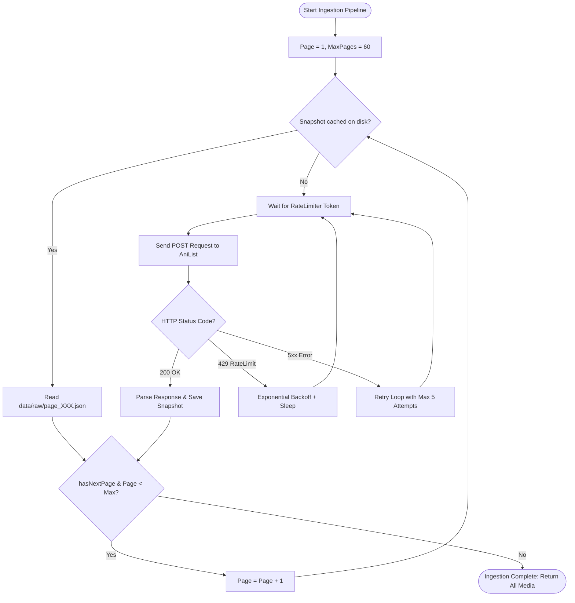

# Step 11: Fault-Tolerant Pagination & Retry Engine

## 1. Process & Purpose
Build a robust pagination engine that crawls up to ~3,000 anime records across 60 pages with exponential backoff, status code validation, and resilient error recovery.

---

## 2. Ingestion Pagination Flowchart



---

## 3. Implementation Code

```python
# src/ingest/anilist_client.py
import httpx
import asyncio
from typing import List, Dict, Any
from src.core.config import settings
from src.core.logger import logger
from src.ingest.rate_limiter import AsyncRateLimiter
from src.ingest.storage import load_page_snapshot, save_page_snapshot

GRAPHQL_QUERY = """
query ($page: Int, $perPage: Int) {
  Page(page: $page, perPage: $perPage) {
    pageInfo { hasNextPage currentPage }
    media(type: ANIME, sort: POPULARITY_DESC, isAdult: false) {
      id
      title { romaji english native }
      description
      genres
      tags { id name rank isMediaSpoiler }
      averageScore
      popularity
      seasonYear
      season
      format
      episodes
      status
      studios(isMain: true) { nodes { id name } }
      coverImage { large }
      siteUrl
      relations {
        edges {
          relationType
          node { id title { romaji english } format }
        }
      }
    }
  }
}
"""

class AniListClient:
    def __init__(self):
        self.url = settings.ANILIST_API_URL
        self.rate_limiter = AsyncRateLimiter()

    async def fetch_page(self, page: int, per_page: int = 50, max_retries: int = 5) -> Dict[str, Any]:
        # Check disk cache first
        cached = load_page_snapshot(page)
        if cached:
            logger.logger.debug(f"Loaded page {page} from disk cache.")
            return cached

        variables = {"page": page, "perPage": per_page}
        headers = {"Content-Type": "application/json", "Accept": "application/json"}

        for attempt in range(1, max_retries + 1):
            await self.rate_limiter.acquire()
            try:
                async with httpx.AsyncClient(timeout=20.0) as client:
                    resp = await client.post(self.url, json={"query": GRAPHQL_QUERY, "variables": variables}, headers=headers)
                    await self.rate_limiter.handle_rate_limit_headers(resp.headers)

                    if resp.status_code == 200:
                        data = resp.json()
                        save_page_snapshot(page, data)
                        logger.logger.info(f"Successfully fetched and cached page {page}/{settings.ANILIST_MAX_PAGES}")
                        return data
                    elif resp.status_code == 429:
                        retry_after = int(resp.headers.get("Retry-After", 2 ** attempt))
                        logger.logger.warning(f"Rate limited (429) on page {page}. Sleeping {retry_after}s (Attempt {attempt}/{max_retries})")
                        await asyncio.sleep(retry_after)
                    else:
                        logger.logger.error(f"HTTP {resp.status_code} on page {page}. Response: {resp.text}")
                        await asyncio.sleep(2 ** attempt)
            except Exception as e:
                logger.logger.error(f"Network error on page {page} attempt {attempt}: {str(e)}")
                await asyncio.sleep(2 ** attempt)

        raise RuntimeError(f"Failed to fetch page {page} after {max_retries} attempts.")

    async def ingest_catalog(self, max_pages: int = 60) -> List[Dict[str, Any]]:
        all_shows = []
        for page in range(1, max_pages + 1):
            page_data = await self.fetch_page(page)
            media_list = page_data.get("data", {}).get("Page", {}).get("media", [])
            all_shows.extend(media_list)
            
            has_next = page_data.get("data", {}).get("Page", {}).get("pageInfo", {}).get("hasNextPage", False)
            if not has_next:
                logger.logger.info(f"Reached end of catalog at page {page}.")
                break
        logger.logger.info(f"Ingestion complete: Collected {len(all_shows)} total anime records.")
        return all_shows
```

---

## 4. Deliverables & Acceptance Criteria
- [x] Full pagination pipeline crawling up to 60 pages / 3,000 anime items.
- [x] Verified exponential backoff for HTTP 429 and 5xx errors.
