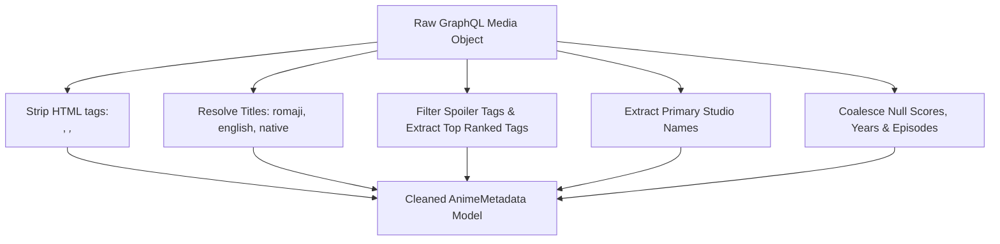

# Step 12: Anime Metadata Extraction & Field Sanitization

## 1. Process & Purpose
Raw API data contains messy HTML tags in descriptions, missing seasons, null tags, and varying title representations. This step cleans, normalizes, and sanitizes the raw fields into consistent internal domain objects.

---

## 2. Transformation & Sanitization Logic



---

## 3. Sanitization Implementation

```python
# src/ingest/transform.py
import re
from typing import Dict, Any, List, Optional
from pydantic import BaseModel, Field

class SanitizedTag(BaseModel):
    id: int
    name: str
    rank: int
    is_spoiler: bool = False

class SanitizedAnime(BaseModel):
    id: int
    title_romaji: str
    title_english: Optional[str] = None
    title_native: Optional[str] = None
    description_clean: str
    genres: List[str] = Field(default_factory=list)
    tags: List[SanitizedTag] = Field(default_factory=list)
    average_score: Optional[int] = None
    popularity: int = 0
    season_year: Optional[int] = None
    season: Optional[str] = None
    format: Optional[str] = None
    episodes: Optional[int] = None
    status: Optional[str] = None
    studios: List[str] = Field(default_factory=list)
    cover_image_url: Optional[str] = None
    site_url: Optional[str] = None
    relations: List[Dict[str, Any]] = Field(default_factory=list)

def clean_html_description(raw_text: Optional[str]) -> str:
    if not raw_text:
        return ""
    # Strip HTML tags
    clean = re.sub(r"<[^>]+>", " ", raw_text)
    # Normalize whitespaces
    clean = re.sub(r"\s+", " ", clean).strip()
    return clean

def sanitize_raw_media(raw: Dict[str, Any]) -> SanitizedAnime:
    titles = raw.get("title") or {}
    romaji = titles.get("romaji") or "Unknown Title"
    english = titles.get("english")
    native = titles.get("native")
    
    desc = clean_html_description(raw.get("description"))
    
    # Process Tags - ignore spoilers, sort by rank descending
    raw_tags = raw.get("tags") or []
    sanitized_tags = []
    for t in raw_tags:
        if t and not t.get("isMediaSpoiler", False):
            sanitized_tags.append(SanitizedTag(
                id=t.get("id", 0),
                name=t.get("name", ""),
                rank=t.get("rank", 0),
                is_spoiler=t.get("isMediaSpoiler", False)
            ))
    sanitized_tags.sort(key=lambda x: x.rank, reverse=True)
    
    # Process Studios
    raw_studios = raw.get("studios", {}).get("nodes", []) or []
    studios = [s.get("name") for s in raw_studios if s and s.get("name")]
    
    # Relations
    raw_relations = raw.get("relations", {}).get("edges", []) or []
    relations = [
        {
            "relation_type": edge.get("relationType"),
            "target_id": edge.get("node", {}).get("id"),
            "target_title": edge.get("node", {}).get("title", {}).get("romaji"),
            "target_format": edge.get("node", {}).get("format")
        }
        for edge in raw_relations if edge and edge.get("node")
    ]
    
    return SanitizedAnime(
        id=raw.get("id"),
        title_romaji=romaji,
        title_english=english,
        title_native=native,
        description_clean=desc,
        genres=raw.get("genres") or [],
        tags=sanitized_tags,
        average_score=raw.get("averageScore"),
        popularity=raw.get("popularity") or 0,
        season_year=raw.get("seasonYear"),
        season=raw.get("season"),
        format=raw.get("format"),
        episodes=raw.get("episodes"),
        status=raw.get("status"),
        studios=studios,
        cover_image_url=raw.get("coverImage", {}).get("large"),
        site_url=raw.get("siteUrl"),
        relations=relations
    )
```

---

## 4. Deliverables & Acceptance Criteria
- [x] HTML regex stripping and whitespace normalization tested and verified.
- [x] Spoiler-tagged community keywords excluded from standard embeddings.
- [x] Strongly typed `SanitizedAnime` output schema generated.
