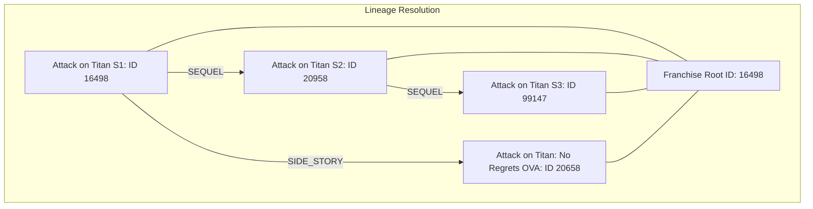

# Step 13: Franchise Relations Graph & Lineage Modeling

## 1. Process & Purpose
In anime retrieval, recommendations easily suffer from "sequel contamination" (e.g. querying *Attack on Titan* returns *Attack on Titan Season 2*, *Season 3*, *The Final Season*, and OVAs). By building a franchise lineage graph from AniList relations (`PREQUEL`, `SEQUEL`, `PARENT`, `SIDE_STORY`, `ALTERNATIVE`), we can assign every show a `franchise_root_id` to enable downstream deduplication.

---

## 2. Franchise Graph Architecture



---

## 3. Implementation: Disjoint-Set / Graph Root Identifier

```python
# src/ingest/franchise_graph.py
from typing import Dict, List, Set
from collections import defaultdict

class FranchiseGraph:
    def __init__(self):
        self.adj = defaultdict(set)
        self.titles = {}

    def add_anime(self, anime_id: int, title: str, relations: List[Dict[str, Any]]):
        self.titles[anime_id] = title
        self.adj[anime_id] # ensure exists
        
        for rel in relations:
            rel_type = rel.get("relation_type")
            target_id = rel.get("target_id")
            # Connect relevant franchise edges
            if rel_type in ["PREQUEL", "SEQUEL", "PARENT", "SIDE_STORY", "ALTERNATIVE", "SPIN_OFF"] and target_id:
                self.adj[anime_id].add(target_id)
                self.adj[target_id].add(anime_id)

    def find_connected_components(self) -> Dict[int, int]:
        """
        Returns a mapping of {anime_id: franchise_root_id}
        where franchise_root_id is the minimum ID in the connected component (usually earliest show).
        """
        visited: Set[int] = set()
        anime_to_root: Dict[int, int] = {}

        for node in self.adj:
            if node not in visited:
                # Traverse component via BFS
                component = []
                queue = [node]
                visited.add(node)
                
                while queue:
                    curr = queue.pop(0)
                    component.append(curr)
                    for neighbor in self.adj[curr]:
                        if neighbor not in visited:
                            visited.add(neighbor)
                            queue.append(neighbor)
                
                # Pick deterministic root (lowest ID)
                root_id = min(component)
                for member_id in component:
                    anime_to_root[member_id] = root_id

        return anime_to_root
```

---

## 4. Deliverables & Acceptance Criteria
- [x] Bidirectional graph traversal clustering sequels, prequels, and spinoffs into connected components.
- [x] Deterministic assignment of `franchise_root_id` to every anime record.
