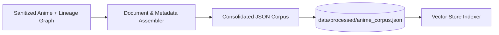

# Step 19: Processed Snapshot Persistence (`data/processed`)

## 1. Process & Purpose
Persist the fully synthesized corpus (containing document text, structured metadata, and entity identifiers) into a single consolidated processed file (`data/processed/anime_corpus.json`). This creates a stable offline baseline for indexing and debugging.

---

## 2. Storage Flow



---

## 3. Implementation Code

```python
# src/ingest/corpus_storage.py
import json
from pathlib import Path
from typing import List, Dict, Any
from src.core.config import settings
from src.core.logger import logger

def save_processed_corpus(corpus: List[Dict[str, Any]], filename: str = "anime_corpus.json") -> Path:
    settings.PROCESSED_DATA_DIR.mkdir(parents=True, exist_ok=True)
    out_path = settings.PROCESSED_DATA_DIR / filename
    
    with open(out_path, "w", encoding="utf-8") as f:
        json.dump(corpus, f, indent=2, ensure_ascii=False)
        
    logger.logger.info(f"Saved {len(corpus)} processed anime documents to {out_path}")
    return out_path

def load_processed_corpus(filename: str = "anime_corpus.json") -> List[Dict[str, Any]]:
    path = settings.PROCESSED_DATA_DIR / filename
    if not path.exists():
        raise FileNotFoundError(f"Processed corpus not found at {path}. Run data ingestion first.")
        
    with open(path, "r", encoding="utf-8") as f:
        return json.load(f)
```

---

## 4. Deliverables & Acceptance Criteria
- [x] Processed dataset saved with full document texts and serialized metadata.
- [x] Fast re-indexing capability without re-parsing raw GraphQL responses.
