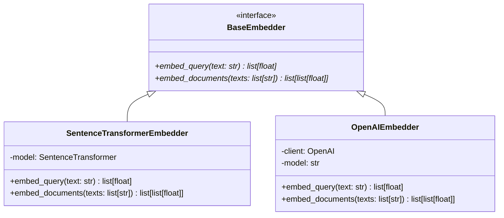

# Step 21: Abstract Embedder Interface (`BaseEmbedder`)

## 1. Process & Purpose
Implement a unified interface that encapsulates sentence-transformers (local) and OpenAI embeddings (cloud), allowing switching providers via configuration with zero changes to downstream search code.

---

## 2. Class Hierarchy



---

## 3. Implementation Code

```python
# src/retrieval/embedder.py
from typing import List
from sentence_transformers import SentenceTransformer
from openai import OpenAI
from src.core.interfaces import BaseEmbedder
from src.core.config import settings

class SentenceTransformerEmbedder(BaseEmbedder):
    def __init__(self, model_name: str = settings.LOCAL_EMBEDDING_MODEL):
        self.model = SentenceTransformer(model_name)

    def embed_query(self, text: str) -> List[float]:
        return self.model.encode(text, convert_to_numpy=True).tolist()

    def embed_documents(self, texts: List[str]) -> List[List[float]]:
        return self.model.encode(texts, batch_size=32, show_progress_bar=False, convert_to_numpy=True).tolist()

class OpenAIEmbedder(BaseEmbedder):
    def __init__(self, api_key: str = settings.OPENAI_API_KEY, model: str = settings.OPENAI_EMBEDDING_MODEL):
        self.client = OpenAI(api_key=api_key)
        self.model = model

    def embed_query(self, text: str) -> List[float]:
        resp = self.client.embeddings.create(input=[text], model=self.model)
        return resp.data[0].embedding

    def embed_documents(self, texts: List[str]) -> List[List[float]]:
        resp = self.client.embeddings.create(input=texts, model=self.model)
        return [item.embedding for item in resp.data]

def get_embedder() -> BaseEmbedder:
    if settings.EMBEDDING_PROVIDER == "openai":
        return OpenAIEmbedder()
    return SentenceTransformerEmbedder()
```

---

## 4. Deliverables & Acceptance Criteria
- [x] Embedder factory returning compliant `BaseEmbedder` instance.
- [x] Both local and cloud embedding providers tested.
