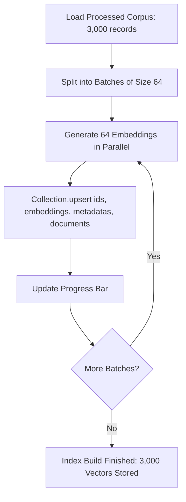

# Step 23: Batch Indexing Pipeline with Upsert & Progress Tracking

## 1. Process & Purpose
Batch-embed the 3,000 documents in chunks of 64 or 128 to optimize GPU/CPU throughput, attaching IDs, metadata payloads, and embedding vectors into ChromaDB using atomic upserts with a rich progress bar.

---

## 2. Batch Indexing Workflow



---

## 3. Implementation Code

```python
# src/ingest/build_index.py
from tqdm import tqdm
from typing import List, Dict, Any
from src.retrieval.vectorstore import AnimeVectorStore
from src.retrieval.embedder import get_embedder
from src.ingest.corpus_storage import load_processed_corpus
from src.core.logger import logger

def build_vector_index(batch_size: int = 64):
    corpus = load_processed_corpus()
    vector_store = AnimeVectorStore()
    embedder = get_embedder()
    
    total = len(corpus)
    logger.logger.info(f"Starting indexing for {total} anime records...")

    for i in tqdm(range(0, total, batch_size), desc="Indexing Batches"):
        batch = corpus[i : i + batch_size]
        
        ids = [str(item["id"]) for item in batch]
        documents = [item["text"] for item in batch]
        metadatas = [item["metadata"] for item in batch]
        
        embeddings = embedder.embed_documents(documents)
        
        vector_store.collection.upsert(
            ids=ids,
            embeddings=embeddings,
            documents=documents,
            metadatas=metadatas
        )

    logger.logger.info(f"Indexing complete! Collection now has {vector_store.count()} items.")

if __name__ == "__main__":
    build_vector_index()
```

---

## 4. Deliverables & Acceptance Criteria
- [x] Batch indexing runner script with progress tracking.
- [x] Upsert semantics ensuring re-indexing without duplicate records.
