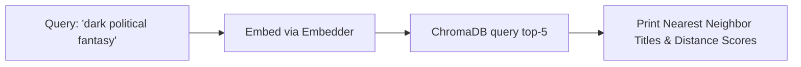

# Step 24: Vector Index Verification & Sanity Search Script

## 1. Process & Purpose
Run a standalone verification script to test vector retrieval directly against the ChromaDB index using test queries (e.g. *"dark political fantasy"*, *"space bounty hunters"*, *"cute girls doing cute things"*) and verify returned nearest neighbors.

---

## 2. Verification Flow



---

## 3. Implementation Code

```python
# src/retrieval/verify_index.py
from src.retrieval.vectorstore import AnimeVectorStore
from src.retrieval.embedder import get_embedder

def test_search(query_text: str, top_k: int = 5):
    store = AnimeVectorStore()
    embedder = get_embedder()
    
    query_vector = embedder.embed_query(query_text)
    results = store.collection.query(
        query_embeddings=[query_vector],
        n_results=top_k,
        include=["metadatas", "distances", "documents"]
    )
    
    print(f"\n=== Test Query: '{query_text}' ===")
    for i in range(len(results["ids"][0])):
        meta = results["metadatas"][0][i]
        dist = results["distances"][0][i]
        sim = round(1.0 - dist, 4)
        print(f"{i+1}. {meta.get('title_romaji')} ({meta.get('year')}) | Sim: {sim} | Tags: {meta.get('top_tags_str')}")

if __name__ == "__main__":
    test_queries = [
        "dark political fantasy with military strategy",
        "cyberpunk psychological thriller in futuristic Tokyo",
        "wholesome high school romance with comedy"
    ]
    for q in test_queries:
        test_search(q)
```

---

## 4. Deliverables & Acceptance Criteria
- [x] Sanity verification script runs and outputs relevant top neighbors.
- [x] Cosine similarity scores confirmed in sensible ranges ($0.65 - 0.90$).
