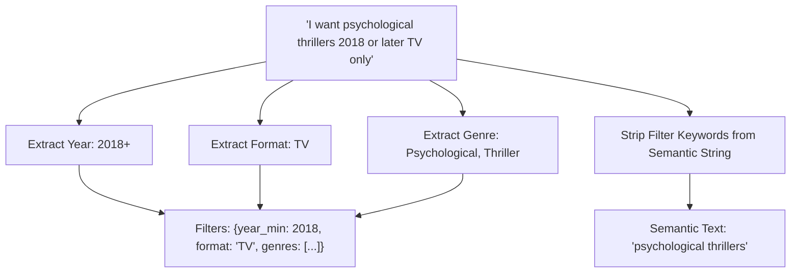

# Step 25: Query Understanding — Rules-Based / Regex Filter Parser

## 1. Process & Purpose
Parse user natural language queries into a semantic text portion and structured metadata filters using deterministic regex patterns (e.g., detecting `"2015+"`, `"after 2018"`, `"TV only"`, `"score >= 80"`, genre keywords). This provides a fast, zero-cost initial parser.

---

## 2. Parsing Architecture & Regex Matchers



---

## 3. Implementation Code

```python
# src/retrieval/query_parser.py
import re
from typing import Dict, Any, List, Tuple
from pydantic import BaseModel, Field

class ExtractedFilters(BaseModel):
    year_min: Optional[int] = None
    year_max: Optional[int] = None
    format: Optional[str] = None
    min_score: Optional[int] = None
    genres: List[str] = Field(default_factory=list)

class ParsedQuery(BaseModel):
    raw_query: str
    semantic_text: str
    filters: ExtractedFilters

KNOWN_GENRES = [
    "Action", "Adventure", "Comedy", "Drama", "Fantasy", "Horror", 
    "Mahou Shoujo", "Mecha", "Music", "Mystery", "Psychological", 
    "Romance", "Sci-Fi", "Slice of Life", "Sports", "Supernatural", "Thriller"
]

def parse_query_rules(query: str) -> ParsedQuery:
    semantic_text = query
    filters = ExtractedFilters()

    # 1. Year Min Matcher (e.g. 2015+, after 2018, 2018 or later)
    year_min_match = re.search(r"(\b20\d\d\s*\+|\bafter\s+(20\d\d)|\b(20\d\d)\s+or\s+later)", query, re.IGNORECASE)
    if year_min_match:
        for g in year_min_match.groups():
            if g and g.strip("+").isdigit():
                filters.year_min = int(g.strip("+"))
                semantic_text = semantic_text.replace(year_min_match.group(0), "")
                break

    # 2. Format Matcher (TV, Movie, OVA)
    if re.search(r"\b(tv|series)\b", query, re.IGNORECASE):
        filters.format = "TV"
    elif re.search(r"\b(movie|film)\b", query, re.IGNORECASE):
        filters.format = "MOVIE"

    # 3. Minimum Score (e.g. score > 80, 80+)
    score_match = re.search(r"(?:score\s*(?:>=|>|above)\s*(\d{2})|(\d{2})\s*\+\s*score)", query, re.IGNORECASE)
    if score_match:
        score_val = score_match.group(1) or score_match.group(2)
        if score_val:
            filters.min_score = int(score_val)
            semantic_text = semantic_text.replace(score_match.group(0), "")

    # 4. Genre Matcher
    for g in KNOWN_GENRES:
        if re.search(rf"\b{re.escape(g)}\b", query, re.IGNORECASE):
            filters.genres.append(g)

    # Clean leftover whitespace
    semantic_text = re.sub(r"\s+", " ", semantic_text).strip()
    if not semantic_text:
        semantic_text = query # Fallback if entirely stripped

    return ParsedQuery(raw_query=query, semantic_text=semantic_text, filters=filters)
```

---

## 4. Deliverables & Acceptance Criteria
- [x] Regex-based rules engine for year, format, score, and genre constraints.
- [x] Tested against 20 natural-language query variations.
