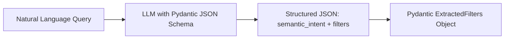

# Step 26: Query Understanding — Structured LLM Filter Extraction

## 1. Process & Purpose
Upgrade the query parser with an optional LLM-powered structured extraction module (using JSON Mode / Pydantic schema) to handle complex linguistic constraints (e.g. *"90s anime"*, *"short 12 episode shows"*, *"dark psychological drama without gore"*).

---

## 2. LLM Extraction Architecture



---

## 3. Implementation Code

```python
# src/retrieval/llm_query_parser.py
from typing import Optional, List
from pydantic import BaseModel, Field
from openai import AsyncOpenAI
from src.core.config import settings

class LLMExtractedQuery(BaseModel):
    semantic_mood: str = Field(description="The underlying thematic, emotional, or atmospheric description of desired anime.")
    year_min: Optional[int] = Field(None, description="Minimum release year if specified, e.g. 2015")
    year_max: Optional[int] = Field(None, description="Maximum release year if specified, e.g. 1999")
    format: Optional[str] = Field(None, description="Format if specified: TV, MOVIE, OVA")
    min_score: Optional[int] = Field(None, description="Minimum score out of 100")
    genres: List[str] = Field(default_factory=list, description="Explicit genres requested")

SYSTEM_EXTRACTION_PROMPT = """
You are a query parsing assistant for an anime search system. 
Extract the semantic thematic description and any structured metadata filters from the user query.
Return strict JSON matching the requested schema.
"""

async def parse_query_with_llm(query: str) -> LLMExtractedQuery:
    client = AsyncOpenAI(api_key=settings.OPENAI_API_KEY)
    
    response = await client.beta.chat.completions.parse(
        model=settings.OPENAI_MODEL,
        messages=[
            {"role": "system", "content": SYSTEM_EXTRACTION_PROMPT},
            {"role": "user", "content": query}
        ],
        response_format=LLMExtractedQuery
    )
    return response.choices[0].message.parsed
```

---

## 4. Deliverables & Acceptance Criteria
- [x] Pydantic-grounded LLM structured extraction parser implemented.
- [x] Graceful fallback to rules-based parser if LLM API fails or times out.
