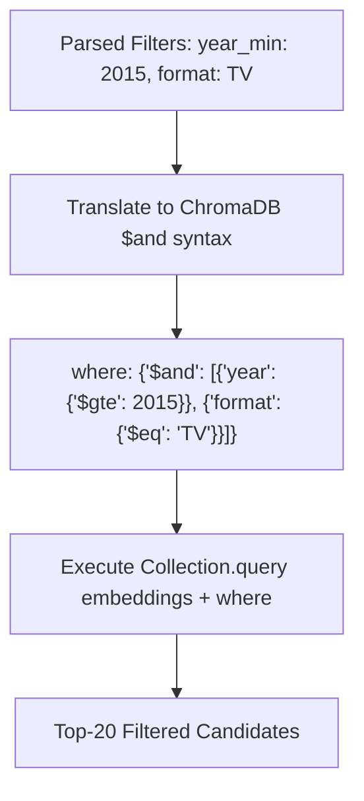

# Step 27: Semantic Vector Search with Metadata `where` Clauses

## 1. Process & Purpose
Translate parsed query filters into ChromaDB native `where` syntax, embedding the semantic query text and executing a hybrid vector search that retrieves candidate shows matching both semantic similarity and categorical constraints.

---

## 2. Filter Translation Logic



---

## 3. Implementation Code

```python
# src/retrieval/search.py
from typing import Dict, Any, List, Optional
from src.retrieval.vectorstore import AnimeVectorStore
from src.retrieval.embedder import BaseEmbedder
from src.retrieval.query_parser import ExtractedFilters

def build_chroma_filter(filters: ExtractedFilters) -> Optional[Dict[str, Any]]:
    conditions = []
    
    if filters.year_min:
        conditions.append({"year": {"$gte": filters.year_min}})
    if filters.year_max:
        conditions.append({"year": {"$lte": filters.year_max}})
    if filters.format:
        conditions.append({"format": {"$eq": filters.format}})
    if filters.min_score:
        conditions.append({"average_score": {"$gte": filters.min_score}})

    if not conditions:
        return None
    if len(conditions) == 1:
        return conditions[0]
    return {"$and": conditions}

def search_candidates(
    store: AnimeVectorStore,
    embedder: BaseEmbedder,
    semantic_text: str,
    filters: ExtractedFilters,
    top_k: int = 20
) -> List[Dict[str, Any]]:
    query_vector = embedder.embed_query(semantic_text)
    chroma_where = build_chroma_filter(filters)
    
    results = store.collection.query(
        query_embeddings=[query_vector],
        n_results=top_k,
        where=chroma_where,
        include=["metadatas", "distances", "documents"]
    )
    
    candidates = []
    if results and results["ids"] and len(results["ids"][0]) > 0:
        for i in range(len(results["ids"][0])):
            candidates.append({
                "id": results["ids"][0][i],
                "document": results["documents"][0][i],
                "metadata": results["metadatas"][0][i],
                "distance": results["distances"][0][i],
                "similarity": round(1.0 - results["distances"][0][i], 4)
            })
    return candidates
```

---

## 4. Deliverables & Acceptance Criteria
- [x] ChromaDB `where` query constructor supporting compound numerical and categorical filters.
- [x] Returns structured list of Top-K candidates with similarity scores.
