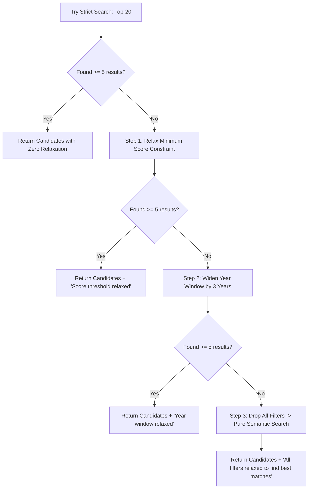

# Step 28: Progressive Filter Relaxation Strategy

## 1. Process & Purpose
When users apply overly strict constraints (e.g. *"2024+, Psychological Thriller, Score >= 90"*), filtered vector search might return fewer than desired candidates (or zero results). Rather than failing silently, the system executes a progressive relaxation strategy, loosening constraints sequentially while notifying the user of what was relaxed.

---

## 2. Relaxation Sequence & Hierarchy



---

## 3. Implementation Code

```python
# src/retrieval/relaxation.py
import copy
from typing import List, Dict, Any, Tuple
from src.retrieval.search import search_candidates
from src.retrieval.query_parser import ExtractedFilters
from src.retrieval.vectorstore import AnimeVectorStore
from src.retrieval.embedder import BaseEmbedder

def search_with_relaxation(
    store: AnimeVectorStore,
    embedder: BaseEmbedder,
    semantic_text: str,
    initial_filters: ExtractedFilters,
    min_results_needed: int = 5,
    top_k: int = 20
) -> Tuple[List[Dict[str, Any]], List[str]]:
    
    relaxation_notes = []
    current_filters = copy.deepcopy(initial_filters)
    
    # 1. Attempt strict search
    candidates = search_candidates(store, embedder, semantic_text, current_filters, top_k=top_k)
    if len(candidates) >= min_results_needed:
        return candidates, relaxation_notes

    # 2. Relax score constraint
    if current_filters.min_score is not None:
        relaxation_notes.append(f"Relaxed minimum score filter from {current_filters.min_score}")
        current_filters.min_score = None
        candidates = search_candidates(store, embedder, semantic_text, current_filters, top_k=top_k)
        if len(candidates) >= min_results_needed:
            return candidates, relaxation_notes

    # 3. Relax year constraint
    if current_filters.year_min is not None:
        relaxation_notes.append(f"Relaxed year filter from {current_filters.year_min}+")
        current_filters.year_min = None
        candidates = search_candidates(store, embedder, semantic_text, current_filters, top_k=top_k)
        if len(candidates) >= min_results_needed:
            return candidates, relaxation_notes

    # 4. Final Fallback: Pure semantic search
    if current_filters.format is not None or current_filters.genres:
        relaxation_notes.append("Relaxed format/genre filters to provide best thematic matches.")
        candidates = search_candidates(store, embedder, semantic_text, ExtractedFilters(), top_k=top_k)

    return candidates, relaxation_notes
```

---

## 4. Deliverables & Acceptance Criteria
- [x] Multi-tier filter relaxation engine ensuring non-empty result sets.
- [x] User-facing relaxation audit logs provided to frontend.
