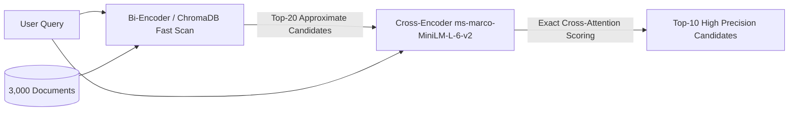

# Step 29: Cross-Encoder Reranker Integration (`ms-marco-MiniLM-L-6-v2`)

## 1. Process & Purpose
Bi-encoder vector search encodes query and documents separately, capturing broad semantic neighborhood but missing nuanced token interactions. A Cross-Encoder feeds the (query, document) pair jointly through transformer self-attention layers, computing precise relevance logits to re-rank the Top-20 retrieved candidates down to the Top-10.

---

## 2. Two-Stage Retrieval Architecture



---

## 3. Implementation Code

```python
# src/retrieval/reranker.py
from typing import List, Dict, Any
from sentence_transformers import CrossEncoder
from src.core.config import settings
from src.core.logger import logger

class Reranker:
    def __init__(self, model_name: str = settings.CROSS_ENCODER_MODEL):
        self.model = CrossEncoder(model_name)
        logger.logger.info(f"Loaded Cross-Encoder model: {model_name}")

    def rerank(self, query: str, candidates: List[Dict[str, Any]], top_k: int = 10) -> List[Dict[str, Any]]:
        if not candidates:
            return []

        # Prepare (query, doc_text) pairs
        pairs = [[query, c["document"]] for c in candidates]
        scores = self.model.predict(pairs)

        # Attach reranker scores
        for idx, score in enumerate(scores):
            candidates[idx]["rerank_score"] = float(score)

        # Sort descending by cross-encoder score
        candidates.sort(key=lambda x: x["rerank_score"], reverse=True)
        return candidates[:top_k]
```

---

## 4. Deliverables & Acceptance Criteria
- [x] Cross-Encoder loaded and integrated into the retrieval pipeline.
- [x] Verified latency overhead of $< 150\text{ms}$ on CPU for 20 candidates.
- [x] Candidates ordered by cross-attention relevance score.
