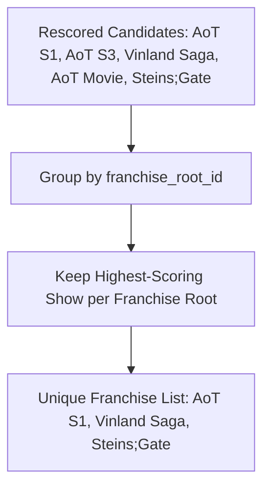

# Step 30: Franchise Deduplication & Lineage Collapse Algorithm

## 1. Process & Purpose
Prevent multiple seasons, spin-offs, or movies of the same franchise from monopolizing the recommendation slots. Using the `franchise_root_id` assigned during Step 13, this algorithm keeps only the highest-scoring entry per franchise lineage (or annotates subsequent entries).

---

## 2. Deduplication Flow



---

## 3. Implementation Code

```python
# src/retrieval/dedup.py
from typing import List, Dict, Any

def deduplicate_franchises(candidates: List[Dict[str, Any]], max_per_franchise: int = 1) -> List[Dict[str, Any]]:
    seen_franchises: Dict[int, int] = {} # franchise_root_id -> count
    deduped = []

    for c in candidates:
        meta = c.get("metadata", {})
        root_id = meta.get("franchise_root_id", meta.get("anilist_id"))
        
        current_count = seen_franchises.get(root_id, 0)
        if current_count < max_per_franchise:
            deduped.append(c)
            seen_franchises[root_id] = current_count + 1

    return deduped
```

---

## 4. Deliverables & Acceptance Criteria
- [x] Elimination of redundant franchise entries in recommendation sets.
- [x] Increases diversity while preserving the top representative entry per show.
