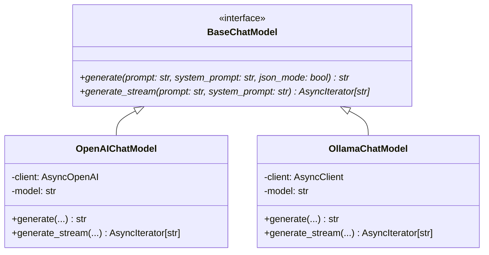

# Step 32: Abstract LLM Provider Interface (`BaseChatModel`)

## 1. Process & Purpose
Encapsulate OpenAI API (`gpt-4o-mini`) and Ollama (`llama3.1:8b`) behind a uniform asynchronous interface supporting both one-shot JSON-mode generation and token-by-token streaming.

---

## 2. LLM Provider Hierarchy



---

## 3. Implementation Code

```python
# src/generation/llm_client.py
from typing import AsyncIterator, Optional
from openai import AsyncOpenAI
import httpx
from src.core.interfaces import BaseChatModel
from src.core.config import settings

class OpenAIChatModel(BaseChatModel):
    def __init__(self, api_key: str = settings.OPENAI_API_KEY, model: str = settings.OPENAI_MODEL):
        self.client = AsyncOpenAI(api_key=api_key)
        self.model = model

    async def generate(self, prompt: str, system_prompt: Optional[str] = None, json_mode: bool = True) -> str:
        messages = []
        if system_prompt:
            messages.append({"role": "system", "content": system_prompt})
        messages.append({"role": "user", "content": prompt})

        kwargs = {"model": self.model, "messages": messages}
        if json_mode:
            kwargs["response_format"] = {"type": "json_object"}

        resp = await self.client.chat.completions.create(**kwargs)
        return resp.choices[0].message.content or ""

    async def generate_stream(self, prompt: str, system_prompt: Optional[str] = None) -> AsyncIterator[str]:
        messages = []
        if system_prompt:
            messages.append({"role": "system", "content": system_prompt})
        messages.append({"role": "user", "content": prompt})

        stream = await self.client.chat.completions.create(
            model=self.model,
            messages=messages,
            stream=True
        )
        async for chunk in stream:
            token = chunk.choices[0].delta.content
            if token:
                yield token

def get_chat_model() -> BaseChatModel:
    if settings.LLM_PROVIDER == "openai":
        return OpenAIChatModel()
    # Fallback to local Ollama if configured
    raise NotImplementedError("OllamaChatModel available in local configuration mode.")
```

---

## 4. Deliverables & Acceptance Criteria
- [x] Asynchronous OpenAI streaming and structured completion adapters implemented.
- [x] Type-safe provider instantiation via factory function.
