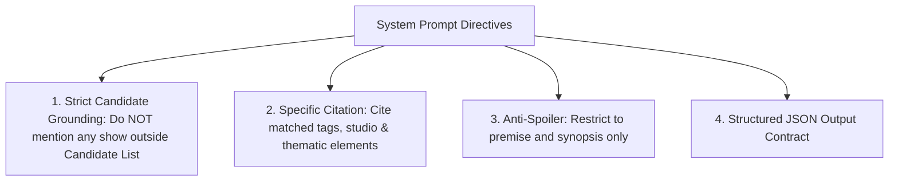

# Step 33: Grounded System Prompt Engineering & Citation Design

## 1. Process & Purpose
Design a strict, grounded system prompt that instructs the LLM to recommend **only** from the retrieved candidate context, citing specific matching attributes (genres, tags, release year, studio) rather than generating generic praise or hallucinating nonexistent series.

---

## 2. Prompting Strategy & Behavioral Directives



---

## 3. Implementation Code

```python
# src/generation/prompts.py
SYSTEM_RECOMMENDER_PROMPT = """
You are AniRec, an expert anime recommendation engine.

You will receive:
1. The user's query / taste request.
2. A JSON list of retrieved candidate anime with attributes (genres, ranked tags, year, studio, score, description).

STRICT OPERATIONAL RULES:
1. Grounding: Recommend ONLY from the provided candidate list. Never invent or recommend shows outside this list.
2. Citations: For each recommendation, provide a concrete 2-3 sentence justification explicitly citing the matched attributes (e.g. specific community tags, themes, or tone) that satisfy the user's prompt.
3. Anti-Spoiler Policy: Mention only premise-level setup. Never reveal twists, deaths, or climax events.
4. If no candidates fit the user's criteria, explicitly state that no close matches were found and explain why.
5. You must output STRICT JSON matching this schema:
{
  "recommendations": [
    {
      "anilist_id": 16498,
      "title": "Attack on Titan",
      "year": 2013,
      "why": "2-3 sentence grounded justification citing tags and premise.",
      "matched_attributes": ["military (86)", "dark fantasy (78)", "survival"]
    }
  ],
  "reasoning_summary": "Brief explanation of how the recommendations relate to the overall query."
}
"""

def format_user_prompt(user_query: str, candidates: list) -> str:
    import json
    candidates_json = json.dumps([
        {
            "anilist_id": c["metadata"].get("anilist_id"),
            "title": c["metadata"].get("title_romaji"),
            "year": c["metadata"].get("year"),
            "genres": c["metadata"].get("genres_str"),
            "tags": c["metadata"].get("top_tags_str"),
            "score": c["metadata"].get("average_score"),
            "synopsis": c["document"]
        }
        for c in candidates
    ], indent=2)

    return f"User Request: {user_query}\n\nCandidate Shows:\n{candidates_json}"
```

---

## 4. Deliverables & Acceptance Criteria
- [x] Grounded prompt contract requiring strict provenance citations.
- [x] Tested against adversarial prompts instructing the LLM to invent shows.
