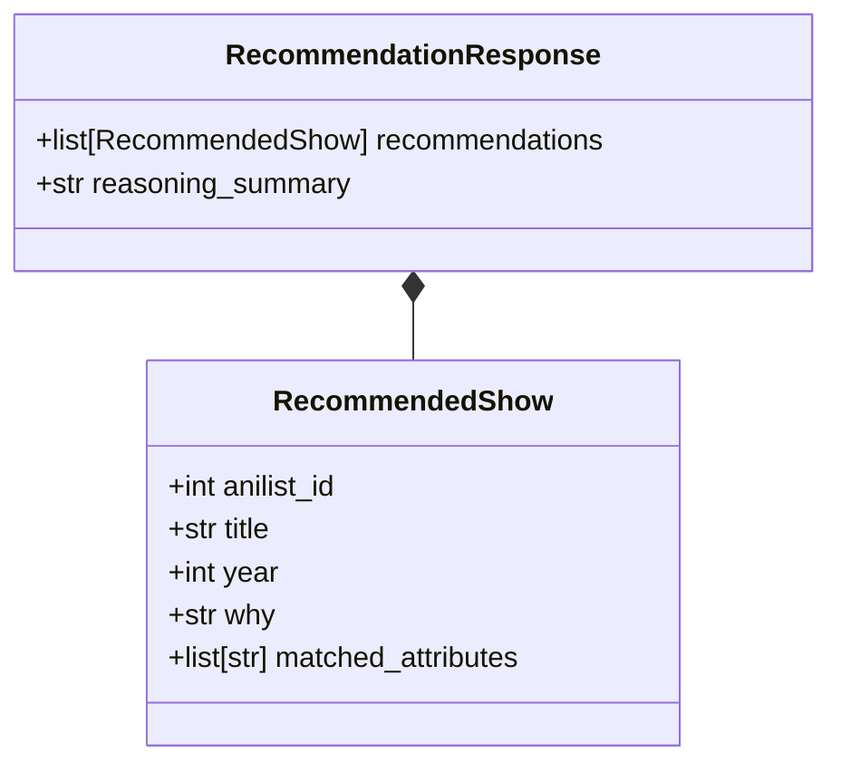

# Step 34: Strict JSON Mode Output Contract

## 1. Process & Purpose
Enforce deterministic JSON responses using Pydantic validation schemas and OpenAI's structured outputs (`response_format={"type": "json_object"}`).

---

## 2. Output Schema Architecture



---

## 3. Implementation Code

```python
# src/generation/schemas.py
from typing import List, Optional
from pydantic import BaseModel, Field

class RecommendedShow(BaseModel):
    anilist_id: int = Field(description="AniList ID of the recommended show")
    title: str = Field(description="Title of the anime")
    year: Optional[int] = Field(None, description="Release year")
    why: str = Field(description="2-3 sentence reason citing matched tags and plot premise")
    matched_attributes: List[str] = Field(default_factory=list, description="Tags/genres that matched query")

class RecommendationOutput(BaseModel):
    recommendations: List[RecommendedShow] = Field(default_factory=list)
    reasoning_summary: str = Field(description="Overview of thematic relevance")
```

---

## 4. Deliverables & Acceptance Criteria
- [x] Strongly typed Pydantic output validation schema.
- [x] Zero JSON parsing errors across test queries.
