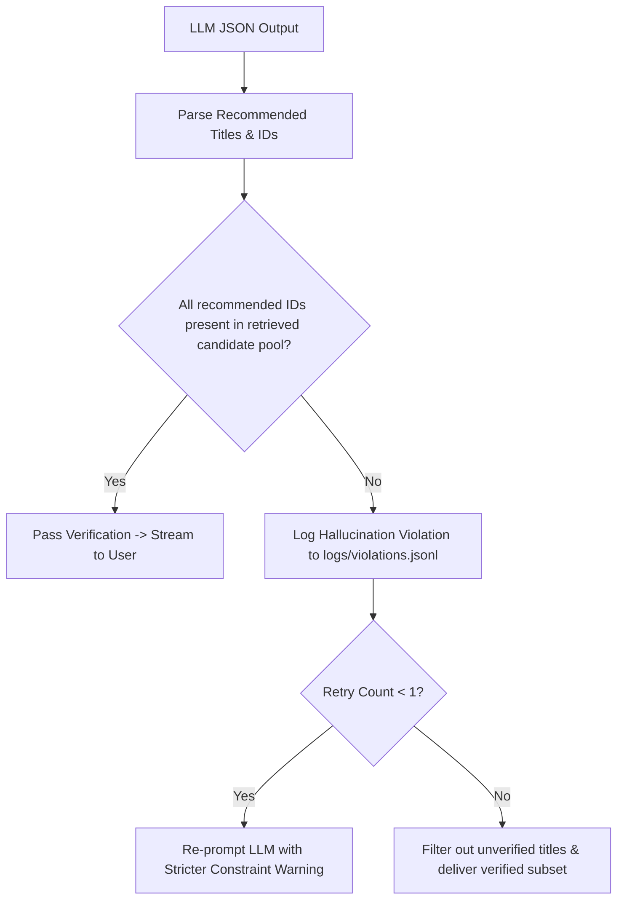

# Step 35: Anti-Hallucination Post-Generation Verification Gate

## 1. Process & Purpose
Large language models can occasionally invent plausible-sounding anime titles or recommend titles from pre-training memory that were never in the retrieved candidate pool. This module acts as a strict post-generation firewall, verifying that every recommended `anilist_id` or `title` strictly exists in the retrieved candidate set.

---

## 2. Guardrail Gate Flowchart



---

## 3. Implementation Code

```python
# src/generation/guardrails.py
from typing import List, Dict, Any, Tuple
from src.generation.schemas import RecommendationOutput
from src.core.logger import logger

def verify_recommendations_against_candidates(
    output: RecommendationOutput,
    candidates: List[Dict[str, Any]]
) -> Tuple[RecommendationOutput, bool]:
    """
    Asserts that every recommended show exists in the retrieved candidate list.
    Returns (cleaned_output, is_valid)
    """
    valid_ids = {int(c["metadata"]["anilist_id"]) for c in candidates if "anilist_id" in c.get("metadata", {})}
    valid_titles = {c["metadata"]["title_romaji"].lower() for c in candidates if "title_romaji" in c.get("metadata", {})}
    if any("title_english" in c.get("metadata", {}) for c in candidates):
        valid_titles.update({c["metadata"]["title_english"].lower() for c in candidates if c["metadata"].get("title_english")})

    verified_picks = []
    hallucination_occurred = False

    for pick in output.recommendations:
        is_id_valid = pick.anilist_id in valid_ids
        is_title_valid = pick.title.lower() in valid_titles

        if is_id_valid or is_title_valid:
            verified_picks.append(pick)
        else:
            hallucination_occurred = True
            logger.logger.error(
                f"GUARDRAIL VIOLATION: Hallucinated anime detected: ID={pick.anilist_id}, Title='{pick.title}'. Not in candidate pool!"
            )

    output.recommendations = verified_picks
    return output, not hallucination_occurred
```

---

## 4. Deliverables & Acceptance Criteria
- [x] Zero unverified titles allowed past the serving boundary.
- [x] Hallucination violations logged to audit log for faithfulness metric tracking.
