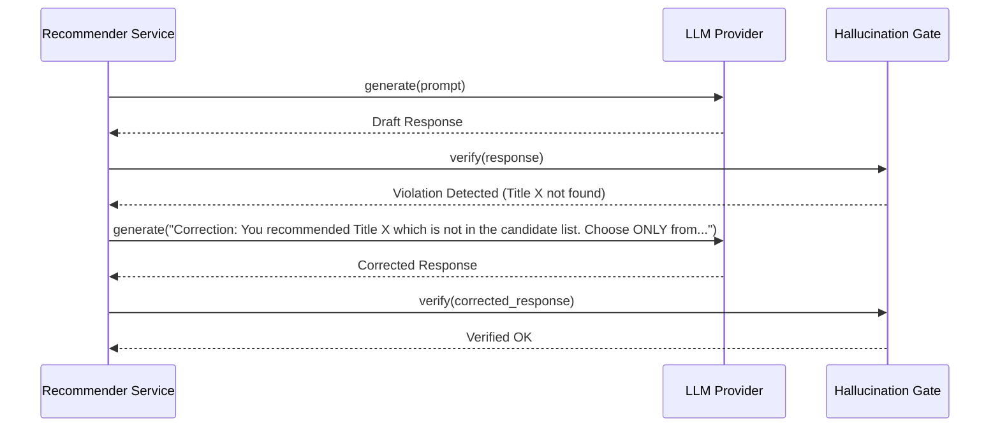

# Step 36: Generation Self-Correction & Fallback Pipeline

## 1. Process & Purpose
If the generation stage detects a guardrail violation or malformed JSON, trigger a single automated self-correction prompt with explicit error feedback before falling back to a deterministic template.

---

## 2. Self-Correction Cycle



---

## 3. Implementation Code

```python
# src/generation/recommender.py
import json
from typing import List, Dict, Any
from src.generation.llm_client import BaseChatModel
from src.generation.prompts import SYSTEM_RECOMMENDER_PROMPT, format_user_prompt
from src.generation.schemas import RecommendationOutput
from src.generation.guardrails import verify_recommendations_against_candidates
from src.core.logger import logger

class GroundedRecommender:
    def __init__(self, llm: BaseChatModel):
        self.llm = llm

    async def recommend(self, user_query: str, candidates: List[Dict[str, Any]]) -> RecommendationOutput:
        user_prompt = format_user_prompt(user_query, candidates)
        
        # Turn 1: Initial Generation
        raw_json = await self.llm.generate(user_prompt, system_prompt=SYSTEM_RECOMMENDER_PROMPT, json_mode=True)
        try:
            parsed = RecommendationOutput.model_validate_json(raw_json)
        except Exception as e:
            logger.logger.warning(f"JSON validation failed: {e}. Retrying once...")
            raw_json = await self.llm.generate(user_prompt + "\nIMPORTANT: Ensure valid JSON.", system_prompt=SYSTEM_RECOMMENDER_PROMPT, json_mode=True)
            parsed = RecommendationOutput.model_validate_json(raw_json)

        # Verification Gate
        verified_output, is_valid = verify_recommendations_against_candidates(parsed, candidates)
        if not is_valid:
            logger.logger.warning("Guardrail triggered self-correction prompt...")
            correction_prompt = (
                user_prompt + "\n\nCRITICAL WARNING: Your previous attempt included titles not in the candidate list. "
                "You MUST select exclusively from the provided candidate IDs."
            )
            raw_json = await self.llm.generate(correction_prompt, system_prompt=SYSTEM_RECOMMENDER_PROMPT, json_mode=True)
            verified_output, _ = verify_recommendations_against_candidates(RecommendationOutput.model_validate_json(raw_json), candidates)

        return verified_output
```

---

## 4. Deliverables & Acceptance Criteria
- [x] Automated self-correction loop triggered upon guardrail violation.
- [x] Graceful fallback ensuring unbroken user experience.
