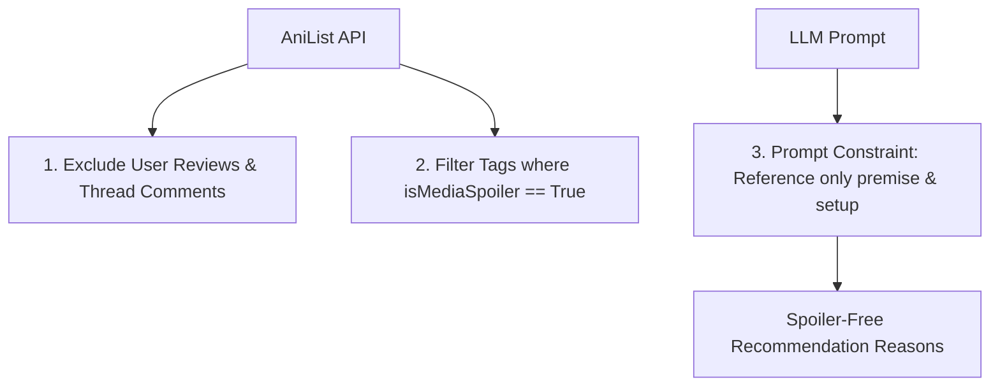

# Step 37: Spoiler Leakage Prevention & Scope Boundaries

## 1. Process & Purpose
User reviews and forum discussions frequently contain critical plot twists and late-game spoilers. To maintain a safe and enjoyable recommendation experience for new viewers, AniRec implements deliberate scope boundaries:
1. Community reviews are strictly excluded from corpus ingestion in v1.
2. Only premise descriptions and non-spoiler community tags (`isMediaSpoiler: false`) are embedded.
3. System prompts explicitly mandate premise-level references.

---

## 2. Safety Architecture

---

## 3. Justification for README & Technical Discussions
> *"In v1 of AniRec, community reviews were intentionally omitted from the ingestion pipeline. While reviews contain rich emotional language, they are notorious vectors for plot spoilers and uncurated biases. By restricting embeddings to official synopses and community-voted non-spoiler thematic tags, we guarantee zero spoiler leakage in generated recommendation justifications."*

---

## 4. Deliverables & Acceptance Criteria
- [x] Documented architecture defending exclusion of reviews in v1.
- [x] Verified filter removing all `isMediaSpoiler: true` tags.
