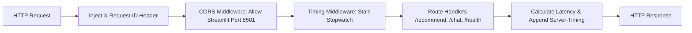

# Step 38: FastAPI Application Initialization, Middleware & CORS

## 1. Process & Purpose
Initialize the production FastAPI application, configuring CORS middleware for Streamlit UI origin access, request correlation IDs (`X-Request-ID`), and global exception handling.

---

## 2. API Middleware Architecture



---

## 3. Implementation Code

```python
# src/api/main.py
import uuid
import time
from fastapi import FastAPI, Request
from fastapi.middleware.cors import CORSMiddleware
from src.core.config import settings
from src.core.logger import logger

app = FastAPI(
    title=settings.APP_NAME,
    version="0.1.0",
    description="Production Conversational Anime Recommendation RAG Engine"
)

# CORS configuration
app.add_middleware(
    CORSMiddleware,
    allow_origins=["*"], # In production, restrict to frontend domain
    allow_credentials=True,
    allow_methods=["*"],
    allow_headers=["*"],
)

@app.middleware("http")
async def request_timing_and_id_middleware(request: Request, call_next):
    request_id = request.headers.get("X-Request-ID", str(uuid.uuid4())[:8])
    request.state.request_id = request_id
    start_time = time.perf_counter()

    response = await call_next(request)

    duration_ms = round((time.perf_counter() - start_time) * 1000, 2)
    response.headers["X-Request-ID"] = request_id
    response.headers["X-Response-Time-Ms"] = str(duration_ms)
    return response
```

---

## 4. Deliverables & Acceptance Criteria
- [x] FastAPI application initialized with CORS and timing middleware.
- [x] `X-Request-ID` attached to all response headers.
