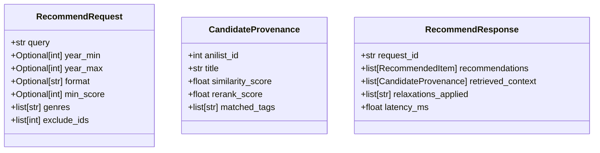

# Step 39: Pydantic Request/Response API Schemas

## 1. Process & Purpose
Define strict, validated Pydantic models for all API endpoints, ensuring type safety at the system boundary for requests and responses.

---

## 2. Schema Hierarchy



---

## 3. Implementation Code

```python
# src/api/schemas.py
from typing import List, Optional, Dict, Any
from pydantic import BaseModel, Field

class RecommendRequest(BaseModel):
    query: str = Field(..., example="I want FMAB's politics but darker, 2015 or later")
    year_min: Optional[int] = Field(None, example=2015)
    year_max: Optional[int] = Field(None)
    format: Optional[str] = Field(None, example="TV")
    min_score: Optional[int] = Field(None, example=75)
    genres: List[str] = Field(default_factory=list, example=["Action", "Drama"])
    exclude_ids: List[int] = Field(default_factory=list, description="IDs to exclude, e.g. already watched")

class RecommendedItem(BaseModel):
    anilist_id: int
    title: str
    year: Optional[int] = None
    why: str
    matched_attributes: List[str] = Field(default_factory=list)
    cover_image_url: Optional[str] = None
    site_url: Optional[str] = None

class CandidateProvenance(BaseModel):
    anilist_id: int
    title: str
    similarity_score: float
    rerank_score: Optional[float] = None
    matched_tags: str

class RecommendResponse(BaseModel):
    request_id: str
    recommendations: List[RecommendedItem]
    reasoning_summary: str
    retrieved_provenance: List[CandidateProvenance]
    relaxations_applied: List[str] = Field(default_factory=list)
    latency_ms: float

class HealthResponse(BaseModel):
    status: str
    indexed_documents: int
    environment: str
```

---

## 4. Deliverables & Acceptance Criteria
- [x] Input and output schemas validated via Pydantic v2.
- [x] Provenance context included in response for full transparency.
