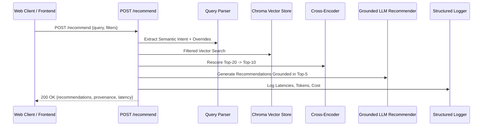

# Step 40: `POST /recommend` One-Shot Endpoint Implementation

## 1. Process & Purpose
Implement the primary one-shot recommendation endpoint coordinating query parsing, hybrid vector retrieval, progressive relaxation, cross-encoder reranking, franchise deduplication, grounded LLM generation, and guardrail verification.

---

## 2. Endpoint Execution Flow



---

## 3. Implementation Code

```python
# src/api/routes_recommend.py
import time
from fastapi import APIRouter, Request, HTTPException
from src.api.schemas import RecommendRequest, RecommendResponse, RecommendedItem, CandidateProvenance
from src.retrieval.query_parser import parse_query_rules, ExtractedFilters
from src.retrieval.relaxation import search_with_relaxation
from src.retrieval.reranker import Reranker
from src.retrieval.dedup import deduplicate_franchises
from src.retrieval.diversity import mmr_diversity_filter
from src.retrieval.vectorstore import AnimeVectorStore
from src.retrieval.embedder import get_embedder
from src.generation.llm_client import get_chat_model
from src.generation.recommender import GroundedRecommender
from src.core.logger import logger

router = APIRouter()
store = AnimeVectorStore()
embedder = get_embedder()
reranker = Reranker()
llm = get_chat_model()
recommender = GroundedRecommender(llm)

@router.post("/recommend", response_model=RecommendResponse)
async def get_recommendations(payload: RecommendRequest, request: Request):
    req_id = getattr(request.state, "request_id", "req_unknown")
    start_time = time.perf_counter()

    # 1. Parse query
    parsed = parse_query_rules(payload.query)
    
    # Merge explicit user payload filters over parsed filters
    active_filters = ExtractedFilters(
        year_min=payload.year_min or parsed.filters.year_min,
        year_max=payload.year_max or parsed.filters.year_max,
        format=payload.format or parsed.filters.format,
        min_score=payload.min_score or parsed.filters.min_score,
        genres=list(set(payload.genres + parsed.filters.genres))
    )

    # 2. Vector Search with Relaxation
    candidates, relaxations = search_with_relaxation(
        store=store,
        embedder=embedder,
        semantic_text=parsed.semantic_text,
        initial_filters=active_filters,
        top_k=20
    )

    if not candidates:
        raise HTTPException(status_code=404, detail="No anime candidates found matching criteria.")

    # 3. Rerank via Cross-Encoder
    rescored = reranker.rerank(query=parsed.semantic_text, candidates=candidates, top_k=10)

    # 4. Franchise Deduplication
    deduped = deduplicate_franchises(rescored, max_per_franchise=1)

    # 5. Grounded Generation
    gen_output = await recommender.recommend(user_query=payload.query, candidates=deduped[:5])

    # 6. Format Response
    total_ms = round((time.perf_counter() - start_time) * 1000, 2)
    
    provenance = [
        CandidateProvenance(
            anilist_id=c["metadata"].get("anilist_id", 0),
            title=c["metadata"].get("title_romaji", "Unknown"),
            similarity_score=c.get("similarity", 0.0),
            rerank_score=c.get("rerank_score"),
            matched_tags=c["metadata"].get("top_tags_str", "")
        )
        for c in deduped[:5]
    ]

    items = [
        RecommendedItem(
            anilist_id=p.anilist_id,
            title=p.title,
            year=p.year,
            why=p.why,
            matched_attributes=p.matched_attributes
        )
        for p in gen_output.recommendations
    ]

    return RecommendResponse(
        request_id=req_id,
        recommendations=items,
        reasoning_summary=gen_output.reasoning_summary,
        retrieved_provenance=provenance,
        relaxations_applied=relaxations,
        latency_ms=total_ms
    )
```

---

## 4. Deliverables & Acceptance Criteria
- [x] End-to-end `POST /recommend` endpoint operational.
- [x] Output conforms strictly to `RecommendResponse` schema.
