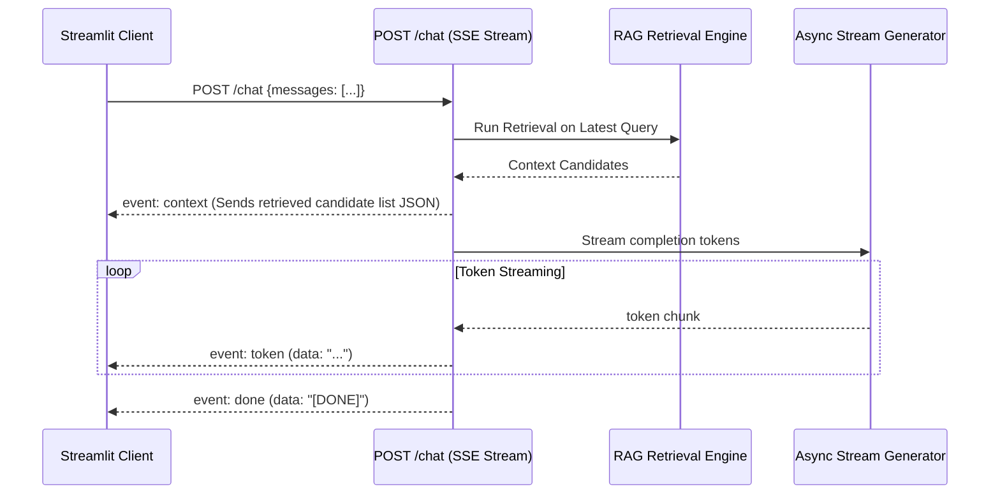

# Step 41: `POST /chat` Multi-Turn SSE Streaming Endpoint

## 1. Process & Purpose
Provide a responsive, conversational multi-turn chat experience using Server-Sent Events (SSE via `sse-starlette`). Tokens stream in real time to minimize perceived user latency (TTFT $< 1.5\text{s}$) while maintaining conversational context.

---

## 2. SSE Streaming Architecture



---

## 3. Implementation Code

```python
# src/api/routes_chat.py
import json
from typing import List, Dict, Any
from fastapi import APIRouter, Request
from sse_starlette.sse import EventSourceResponse
from pydantic import BaseModel
from src.retrieval.query_parser import parse_query_rules
from src.retrieval.relaxation import search_with_relaxation
from src.retrieval.reranker import Reranker
from src.retrieval.dedup import deduplicate_franchises
from src.retrieval.vectorstore import AnimeVectorStore
from src.retrieval.embedder import get_embedder
from src.generation.llm_client import get_chat_model
from src.generation.prompts import SYSTEM_RECOMMENDER_PROMPT, format_user_prompt

router = APIRouter()
store = AnimeVectorStore()
embedder = get_embedder()
reranker = Reranker()
llm = get_chat_model()

class ChatMessage(BaseModel):
    role: str
    content: str

class ChatPayload(BaseModel):
    messages: List[ChatMessage]

@router.post("/chat")
async def chat_stream(payload: ChatPayload, request: Request):
    user_latest_query = payload.messages[-1].content
    
    # 1. Retrieval
    parsed = parse_query_rules(user_latest_query)
    candidates, _ = search_with_relaxation(store, embedder, parsed.semantic_text, parsed.filters, top_k=20)
    rescored = reranker.rerank(parsed.semantic_text, candidates, top_k=10)
    top_candidates = deduplicate_franchises(rescored, max_per_franchise=1)[:5]

    user_prompt = format_user_prompt(user_latest_query, top_candidates)

    async def event_generator():
        # Yield metadata context event
        context_data = [
            {"id": c["metadata"]["anilist_id"], "title": c["metadata"]["title_romaji"]}
            for c in top_candidates
        ]
        yield {"event": "context", "data": json.dumps(context_data)}

        # Stream tokens
        async for token in llm.generate_stream(user_prompt, system_prompt=SYSTEM_RECOMMENDER_PROMPT):
            if await request.is_disconnected():
                break
            yield {"event": "token", "data": token}

        yield {"event": "done", "data": "[DONE]"}

    return EventSourceResponse(event_generator())
```

---

## 4. Deliverables & Acceptance Criteria
- [x] SSE streaming endpoint providing real-time token delivery.
- [x] Disconnection detection preventing orphaned streaming tasks.
