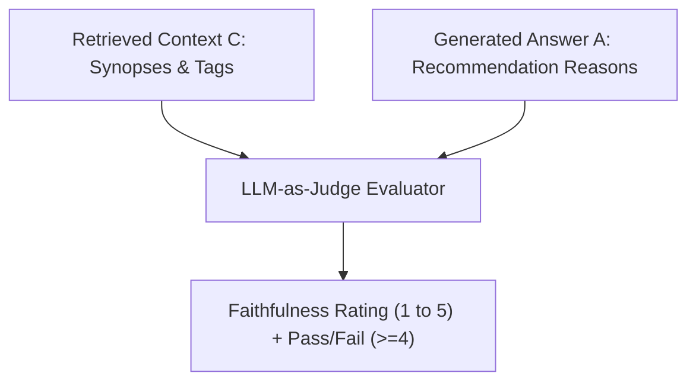

# Step 51: Generation Metrics & LLM-as-Judge Implementation

## 1. Process & Purpose
Evaluate generation quality quantitatively using an **LLM-as-a-judge** to measure **Faithfulness** (verifying that every claim in the recommendation explanation is strictly supported by the retrieved show synopsis and tags) and programmatic **Constraint Satisfaction**.

---

## 2. LLM-as-Judge Protocol



---

## 3. Implementation Code

```python
# evals/judge.py
from openai import AsyncOpenAI
from pydantic import BaseModel, Field
from src.core.config import settings

JUDGE_SYSTEM_PROMPT = """
You are an impartial evaluator assessing the faithfulness of an anime recommendation system.
You will be provided with:
1. Context C: The retrieved information for the anime (synopsis, tags, genres).
2. Answer A: The generated justification for recommending the anime.

TASK:
Determine if every factual claim made in Answer A is strictly supported by Context C.
Rate Faithfulness on a scale of 1 to 5:
- 5: Completely faithful. Every claim directly supported by context.
- 4: Highly faithful. Minor stylistic elaboration without factual errors.
- 3: Partially faithful. Contains 1 unsupported claim.
- 2: Mostly unfaithful. Contains multiple hallucinated facts.
- 1: Completely hallucinated.
"""

class FaithfulnessVerdict(BaseModel):
    score: int = Field(ge=1, le=5, description="Faithfulness score from 1 to 5")
    reasoning: str = Field(description="Explanation of verdict")
    is_faithful: bool = Field(description="True if score >= 4")

async def judge_faithfulness(context: str, answer: str) -> FaithfulnessVerdict:
    client = AsyncOpenAI(api_key=settings.OPENAI_API_KEY)
    
    prompt = f"CONTEXT:\n{context}\n\nANSWER:\n{answer}"
    
    resp = await client.beta.chat.completions.parse(
        model=settings.OPENAI_MODEL,
        messages=[
            {"role": "system", "content": JUDGE_SYSTEM_PROMPT},
            {"role": "user", "content": prompt}
        ],
        response_format=FaithfulnessVerdict
    )
    return resp.choices[0].message.parsed
```

---

## 4. Deliverables & Acceptance Criteria
- [x] LLM-as-judge prompt and Pydantic parser implemented.
- [x] Target threshold: Faithfulness $\ge 0.85$ (85%+ answers scoring $\ge 4$).
