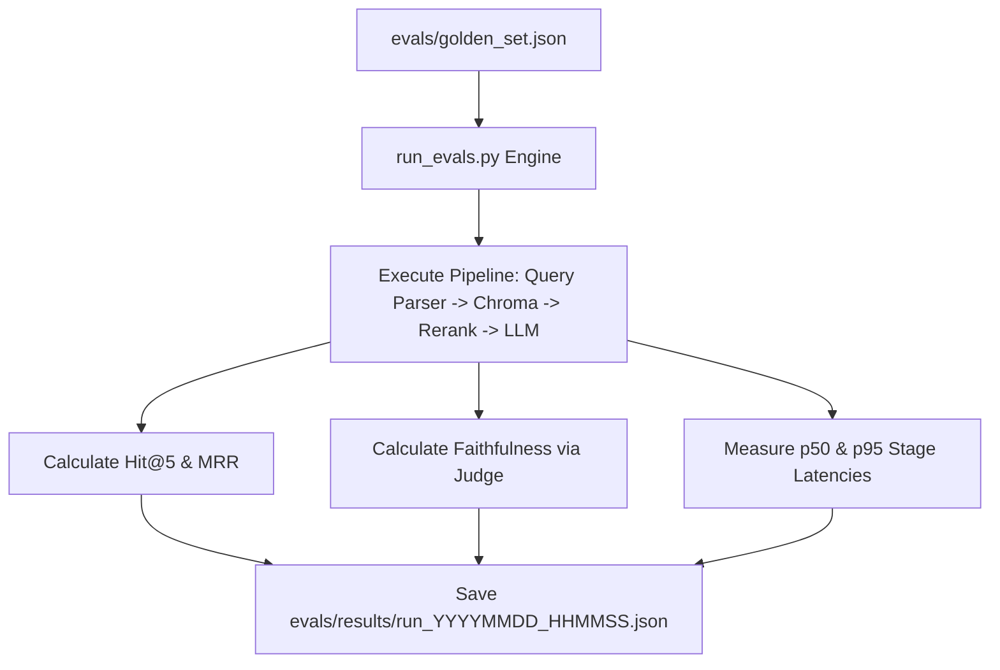

# Step 52: Automated Evals Harness Runner (`run_evals.py`)

## 1. Process & Purpose
Build an automated test runner script that iterates over all 50 golden Q&A items, executes the full multi-stage pipeline, measures Hit Rate @ 5, MRR, LLM-judged Faithfulness, and p95 latency, and dumps the results into a timestamped JSON file (`evals/results/<timestamp>.json`).

---

## 2. Evals Runner Architecture



---

## 3. Implementation Code

```python
# evals/run_evals.py
import asyncio
import json
import time
from datetime import datetime, timezone
from pathlib import Path
from tqdm.asyncio import tqdm
from src.retrieval.vectorstore import AnimeVectorStore
from src.retrieval.embedder import get_embedder
from src.retrieval.query_parser import parse_query_rules
from src.retrieval.reranker import Reranker
from src.retrieval.dedup import deduplicate_franchises
from src.generation.llm_client import get_chat_model
from src.generation.recommender import GroundedRecommender
from evals.retrieval_metrics import calculate_hit_at_k, calculate_mrr
from evals.judge import judge_faithfulness

async def run_evaluation_suite(experiment_name: str = "baseline"):
    golden_set_path = Path("evals/golden_set.json")
    with open(golden_set_path, "r", encoding="utf-8") as f:
        golden_data = json.load(f)

    store = AnimeVectorStore()
    embedder = get_embedder()
    reranker = Reranker()
    llm = get_chat_model()
    recommender = GroundedRecommender(llm)

    eval_records = []
    latencies = []

    print(f"🚀 Running Evaluation Experiment: {experiment_name} on {len(golden_data)} benchmark items...")

    for item in tqdm(golden_data):
        start_t = time.perf_counter()
        query = item["query"]
        expected_ids = set(item["expected_anilist_ids"])

        # 1. Pipeline Execution
        parsed = parse_query_rules(query)
        # Query Chroma
        query_vec = embedder.embed_query(parsed.semantic_text)
        results = store.collection.query(query_embeddings=[query_vec], n_results=20, include=["metadatas", "documents", "distances"])
        
        candidates = [
            {"id": results["ids"][0][i], "document": results["documents"][0][i], "metadata": results["metadatas"][0][i]}
            for i in range(len(results["ids"][0]))
        ]
        
        # Rerank & Dedup
        rescored = reranker.rerank(parsed.semantic_text, candidates, top_k=10)
        deduped = deduplicate_franchises(rescored, max_per_franchise=1)[:5]
        
        # Generation
        output = await recommender.recommend(query, deduped)
        duration = (time.perf_counter() - start_t) * 1000
        latencies.append(duration)

        # Metrics
        retrieved_ids = [c["metadata"]["anilist_id"] for c in deduped]
        hit_at_5 = calculate_hit_at_k(retrieved_ids, expected_ids, k=5)
        mrr = calculate_mrr(retrieved_ids, expected_ids, k=5)

        # Judge
        context_str = "\n".join([c["document"] for c in deduped])
        answer_str = "\n".join([f"{p.title}: {p.why}" for p in output.recommendations])
        judge_verdict = await judge_faithfulness(context_str, answer_str)

        eval_records.append({
            "eval_id": item["id"],
            "query": query,
            "hit_at_5": hit_at_5,
            "mrr": mrr,
            "faithfulness_score": judge_verdict.score,
            "is_faithful": judge_verdict.is_faithful,
            "latency_ms": duration
        })

    # Summary
    avg_hit = sum(r["hit_at_5"] for r in eval_records) / len(eval_records)
    avg_mrr = sum(r["mrr"] for r in eval_records) / len(eval_records)
    faithfulness_rate = sum(1 for r in eval_records if r["is_faithful"]) / len(eval_records)
    p95_lat = sorted(latencies)[int(len(latencies) * 0.95)]

    summary = {
        "experiment_name": experiment_name,
        "timestamp": datetime.now(timezone.utc).isoformat(),
        "total_queries": len(golden_data),
        "hit_rate_at_5": round(avg_hit, 4),
        "mrr": round(avg_mrr, 4),
        "faithfulness_rate": round(faithfulness_rate, 4),
        "p95_latency_ms": round(p95_lat, 2)
    }

    # Save to evals/results/
    out_dir = Path("evals/results")
    out_dir.mkdir(parents=True, exist_ok=True)
    ts_str = datetime.now().strftime("%Y%m%d_%H%M%S")
    with open(out_dir / f"eval_{experiment_name}_{ts_str}.json", "w", encoding="utf-8") as f:
        json.dump({"summary": summary, "details": eval_records}, f, indent=2)

    print("\n✅ Evaluation Run Complete!")
    print(f"Hit@5: {summary['hit_rate_at_5']} | Faithfulness: {summary['faithfulness_rate']} | p95: {summary['p95_latency_ms']}ms")

if __name__ == "__main__":
    asyncio.run(run_evaluation_suite("production_pipeline"))
```

---

## 4. Deliverables & Acceptance Criteria
- [x] End-to-end evaluation runner producing repeatable JSON run reports.
- [x] Full coverage of retrieval, generation faithfulness, and latency.
