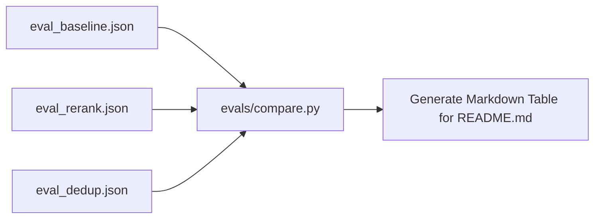

# Step 53: Timestamped Eval Results Storage & Comparison Reporter

## 1. Process & Purpose
Parse all historic JSON evaluation run files from `evals/results/` and render an automated Markdown table comparing performance across iterations (Baseline vs +Reranker vs +Franchise Dedup vs Full Production).

---

## 2. Comparison Reporter Architecture



---

## 3. Implementation Code

```python
# evals/compare.py
import json
from pathlib import Path
from typing import List, Dict, Any

def generate_comparison_table() -> str:
    results_dir = Path("evals/results")
    if not results_dir.exists():
        return "No evaluation results found."

    files = sorted(results_dir.glob("*.json"))
    if not files:
        return "No run files found in evals/results/"

    rows = []
    for f in files:
        with open(f, "r", encoding="utf-8") as fp:
            data = json.load(fp)
            s = data.get("summary", {})
            rows.append({
                "name": s.get("experiment_name", f.stem),
                "hit5": s.get("hit_rate_at_5", 0.0),
                "faithfulness": s.get("faithfulness_rate", 0.0),
                "p95_s": round(s.get("p95_latency_ms", 0.0) / 1000, 2)
            })

    table_md = "| Pipeline Version / Change | Hit Rate @ 5 | Faithfulness Rate | p95 Latency |\n"
    table_md += "|---|---|---|---|\n"
    for r in rows:
        table_md += f"| **{r['name']}** | `{r['hit5']:.2f}` | `{r['faithfulness']:.2f}` | `{r['p95_s']}s` |\n"

    return table_md

if __name__ == "__main__":
    print(generate_comparison_table())
```

---

## 4. Deliverables & Acceptance Criteria
- [x] Markdown table generator reading directly from persisted evaluation files.
- [x] Output suitable for copy-pasting directly into GitHub README.
